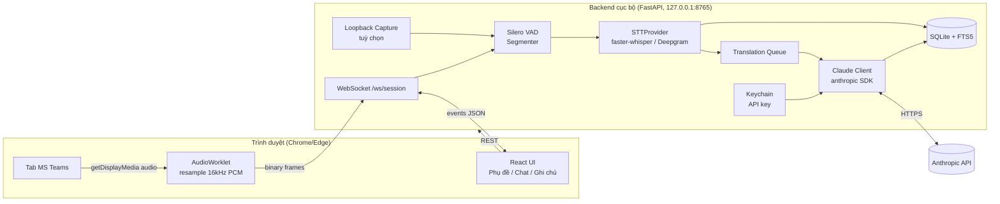
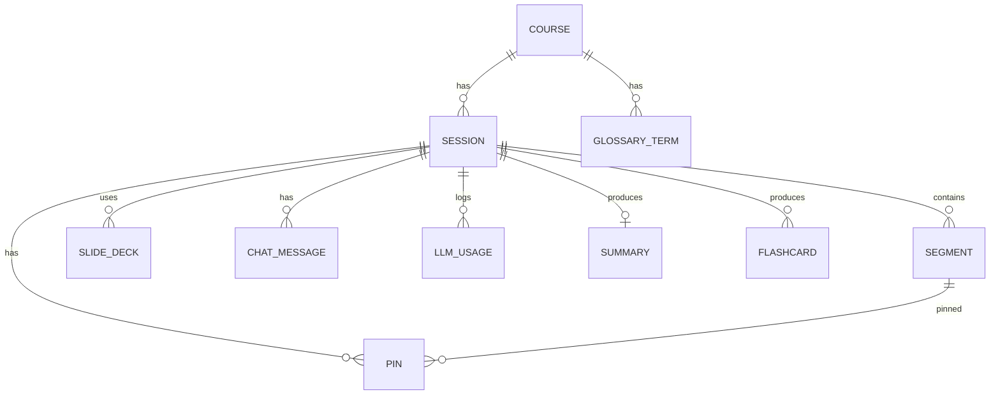
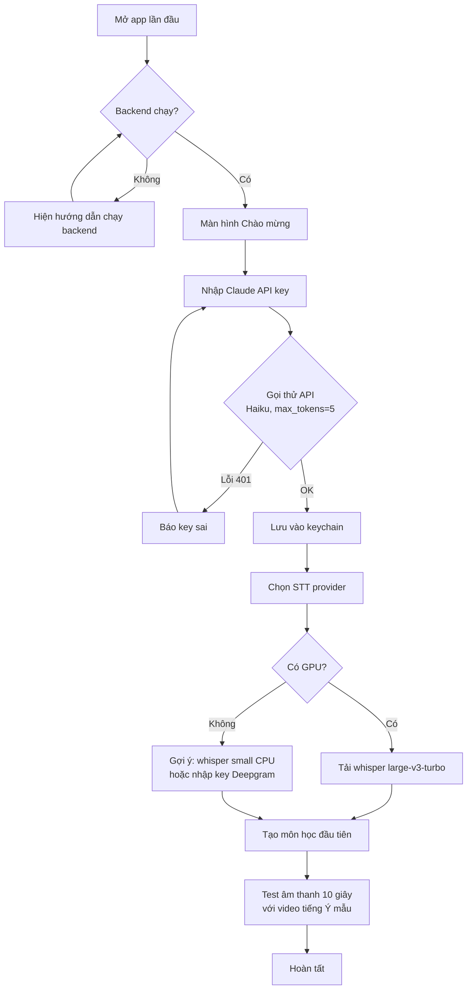
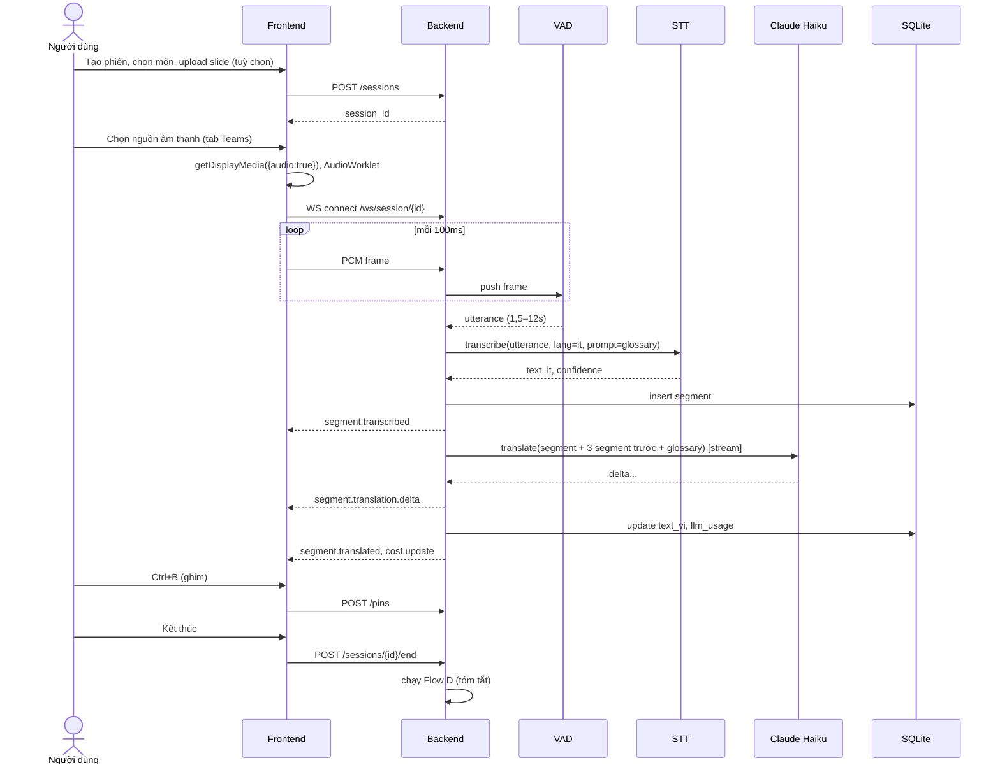
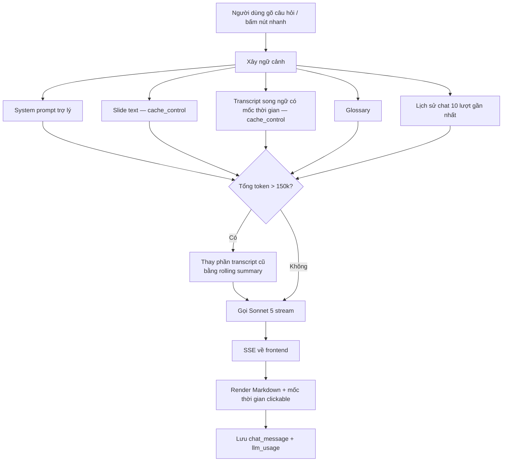
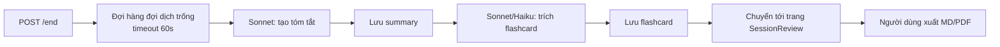

# LezioneLive: Đặc tả ứng dụng (App Specification)

> Trợ lý dịch trực tiếp và học tập cho các buổi học online bằng tiếng Ý trên MS Teams, tích hợp Claude API.

| Mục | Giá trị |
|---|---|
| Phiên bản tài liệu | 1.0 |
| Ngày | 28/09/2026 |
| Tác giả | Nguyễn Anh Sang |
| Trạng thái | Draft, chờ review |
| Ngôn ngữ giao diện | Tiếng Việt (mặc định), English |

---

## Mục lục

1. [Tổng quan](#1-tổng-quan)
2. [Người dùng và User Stories](#2-người-dùng-và-user-stories)
3. [Phạm vi theo giai đoạn](#3-phạm-vi-theo-giai-đoạn)
4. [Yêu cầu chức năng (FR)](#4-yêu-cầu-chức-năng-fr)
5. [Yêu cầu phi chức năng (NFR)](#5-yêu-cầu-phi-chức-năng-nfr)
6. [Kiến trúc hệ thống](#6-kiến-trúc-hệ-thống)
7. [Cấu trúc thư mục dự án](#7-cấu-trúc-thư-mục-dự-án)
8. [Mô hình dữ liệu](#8-mô-hình-dữ-liệu)
9. [Đặc tả API nội bộ](#9-đặc-tả-api-nội-bộ)
10. [Các luồng xử lý (Flows)](#10-các-luồng-xử-lý-flows)
11. [Thiết kế Prompt](#11-thiết-kế-prompt)
12. [Đặc tả giao diện (UI)](#12-đặc-tả-giao-diện-ui)
13. [Cấu hình và quản lý API key](#13-cấu-hình-và-quản-lý-api-key)
14. [Xử lý lỗi](#14-xử-lý-lỗi)
15. [Kế hoạch triển khai (Plan)](#15-kế-hoạch-triển-khai-plan)
16. [Acceptance Criteria (AC)](#16-acceptance-criteria-ac)
17. [Kế hoạch kiểm thử](#17-kế-hoạch-kiểm-thử)
18. [Rủi ro và giảm thiểu](#18-rủi-ro-và-giảm-thiểu)
19. [Câu hỏi mở](#19-câu-hỏi-mở)
20. [Thuật ngữ](#20-thuật-ngữ)

---

## 1. Tổng quan

### 1.1 Bối cảnh

Người dùng là học viên thạc sĩ Data Science (Đại học Salento, Ý). Trước khi sang Ý, người dùng học online qua MS Teams. Bài giảng dùng tiếng Ý, trong khi người dùng chưa có nền tảng tiếng Ý. Rào cản ngôn ngữ gây ra ba hệ quả:

- không hiểu bài giảng theo thời gian thực;
- không đặt được câu hỏi cho giảng viên;
- không có tài liệu đọc được để ôn tập.

### 1.2 Mục tiêu sản phẩm

| # | Mục tiêu | Chỉ số đo |
|---|---|---|
| G1 | Hiểu bài giảng ngay trong buổi học | Bản dịch tiếng Việt xuất hiện ≤ 5 giây (p50) sau khi giảng viên nói xong một câu |
| G2 | Hỏi đáp về nội dung bài giảng trong lúc học | Claude trả lời dựa trên transcript, bắt đầu stream ≤ 3 giây |
| G3 | Có tài liệu ôn tập sau buổi học | Tóm tắt và ghi chú xuất ra trong ≤ 2 phút sau khi kết thúc buổi |
| G4 | Hỗ trợ học tiếng Ý, không chỉ dịch hộ | Mỗi buổi tự tạo ≥ 20 flashcard từ vựng |
| G5 | An toàn và tiết kiệm | API key không rời khỏi máy người dùng; có theo dõi chi phí từng buổi |

### 1.3 Ngoài phạm vi (Non-goals)

- Không phải bot tham gia cuộc họp Teams. Ứng dụng chỉ nghe âm thanh phát ra trên máy người dùng.
- Không dịch giọng nói ra âm thanh (TTS) ở phiên bản 1.
- Không đồng bộ lên cloud hay chia sẻ nhiều người dùng.
- Không phát tán, chia sẻ lại transcript hay bản ghi bài giảng.
- Không ghi hình video.

### 1.4 Giả định

- **A1:** Máy chạy Windows 10/11 hoặc macOS 13 trở lên, có Chrome hoặc Edge bản mới.
- **A2:** Chế độ mặc định là dùng Teams **trên trình duyệt** (Chrome/Edge) để bắt âm thanh của tab. Chế độ phụ là Teams desktop, bắt âm thanh hệ thống (xem mục 6.4).
- **A3:** Người dùng có API key từ Claude Console, còn credit.
- **A4:** Máy có GPU NVIDIA ≥ 6GB VRAM nếu chạy STT cục bộ. Nếu không có, dùng STT cloud.

---

## 2. Người dùng và User Stories

### 2.1 Persona

**Sang, học viên thạc sĩ Data Science**
- Thành thạo tiếng Anh và kỹ thuật, chưa biết tiếng Ý.
- Học buổi chiều hoặc tối theo giờ Việt Nam, mỗi buổi kéo dài 3 tiếng.
- Muốn hiểu bài, nộp bài đúng hạn và dần tự nghe được tiếng Ý.

### 2.2 User Stories

| ID | Là… | Tôi muốn… | Để… | Ưu tiên |
|---|---|---|---|---|
| US-01 | học viên | thấy phụ đề tiếng Ý và bản dịch tiếng Việt song song khi giảng viên nói | hiểu bài theo thời gian thực | Must |
| US-02 | học viên | nhập API key Claude một lần và dùng mãi | không phải nhập lại mỗi buổi | Must |
| US-03 | học viên | lưu toàn bộ transcript của buổi học | ôn lại sau | Must |
| US-04 | học viên | hỏi Claude "thầy vừa nói gì về X?" | hiểu đoạn mình bị lỡ | Must |
| US-05 | học viên | upload slide PDF của buổi học | Claude dịch và trả lời chính xác hơn | Should |
| US-06 | học viên | định nghĩa bảng thuật ngữ Ý → Việt | thuật ngữ được dịch thống nhất | Should |
| US-07 | học viên | bấm phím tắt để ghim đoạn "chưa hiểu" | sau buổi học hỏi lại Claude | Should |
| US-08 | học viên | viết câu hỏi tiếng Việt và nhận bản tiếng Ý lịch sự | gửi vào chat Teams cho giảng viên | Should |
| US-09 | học viên | nhận tóm tắt sau buổi học (ý chính, bài tập, deadline) | không bỏ sót việc cần làm | Must |
| US-10 | học viên | xuất ghi chú ra Markdown hoặc PDF | lưu trữ và in | Should |
| US-11 | học viên | tự động có flashcard từ vựng tiếng Ý từ buổi học | học tiếng Ý song song | Could |
| US-12 | học viên | ẩn cột dịch và chỉ hiện khi bấm | luyện nghe | Could |
| US-13 | học viên | xem chi phí API của từng buổi | kiểm soát ngân sách | Should |
| US-14 | học viên | tìm kiếm trong các buổi học cũ | tra cứu kiến thức | Could |

---

## 3. Phạm vi theo giai đoạn

| Giai đoạn | Nội dung | User Stories |
|---|---|---|
| **Phase 0: Spike** | Kiểm chứng: bắt audio tab Chrome, Whisper nhận dạng tiếng Ý, đo độ trễ | (kỹ thuật) |
| **Phase 1: MVP** | Phụ đề song ngữ realtime, lưu transcript, cài đặt API key | US-01, 02, 03 |
| **Phase 2: Trợ lý** | Chat hỏi đáp trên transcript, upload slide, bảng thuật ngữ, ghim đoạn, soạn câu hỏi tiếng Ý | US-04 → 08 |
| **Phase 3: Sau buổi học** | Tóm tắt, xuất ghi chú, theo dõi chi phí | US-09, 10, 13 |
| **Phase 4: Học tiếng Ý** | Flashcard, chế độ ẩn bản dịch, tìm kiếm lịch sử | US-11, 12, 14 |

---

## 4. Yêu cầu chức năng (FR)

### 4.1 Thu âm (Audio Capture)

| ID | Yêu cầu |
|---|---|
| FR-AC-01 | Cho phép chọn nguồn âm thanh: (a) một tab trình duyệt qua `getDisplayMedia`, (b) âm thanh hệ thống (loopback) do backend bắt. |
| FR-AC-02 | Chuyển âm thanh về PCM 16-bit, mono, 16 kHz trước khi gửi đi. |
| FR-AC-03 | Hiển thị đồng hồ mức âm (VU meter) để người dùng biết đang nhận được âm thanh. |
| FR-AC-04 | Cảnh báo nếu im lặng liên tục > 60 giây trong khi phiên đang chạy. |
| FR-AC-05 | Hỗ trợ Tạm dừng / Tiếp tục mà không làm mất phiên. |
| FR-AC-06 | Tuỳ chọn lưu file âm thanh gốc. **Mặc định TẮT** (vì quyền riêng tư). |

### 4.2 Nhận dạng giọng nói (STT)

| ID | Yêu cầu |
|---|---|
| FR-STT-01 | Dùng VAD (Silero) để cắt audio thành các đoạn theo khoảng lặng: tối thiểu 1,5 giây, tối đa 12 giây. |
| FR-STT-02 | Nhận dạng tiếng Ý (`language="it"`) qua một interface `STTProvider` để thay provider dễ dàng. |
| FR-STT-03 | Provider mặc định: `faster-whisper` model `large-v3-turbo` (GPU) hoặc `small` (CPU). Provider thay thế: Deepgram / Azure Speech (`it-IT`). |
| FR-STT-04 | Truyền bảng thuật ngữ vào `initial_prompt` (Whisper) hoặc `keywords` (cloud) để tăng độ chính xác thuật ngữ. |
| FR-STT-05 | Mỗi segment có: `id`, `t_start`, `t_end`, `text_it`, `confidence`. |
| FR-STT-06 | Segment có confidence thấp (< 0,5) được đánh dấu để hiển thị khác biệt trên UI. |

### 4.3 Dịch (Translation)

| ID | Yêu cầu |
|---|---|
| FR-TR-01 | Dịch từng segment Ý → Việt bằng `claude-haiku-4-5-20251001`, stream kết quả. |
| FR-TR-02 | Ngữ cảnh dịch gồm: bảng thuật ngữ, 3 segment trước đó (gốc và bản dịch), tiêu đề môn học, và tóm tắt slide nếu có. |
| FR-TR-03 | Tuỳ chọn thêm ngôn ngữ phụ là tiếng Anh (hiển thị cột thứ 3 hoặc tooltip). |
| FR-TR-04 | Giữ nguyên công thức, ký hiệu toán học, tên riêng và code. |
| FR-TR-05 | Dịch lại khi người dùng sửa text tiếng Ý của segment. |
| FR-TR-06 | Chạy song song tối đa 3 request dịch, nhưng hiển thị theo đúng thứ tự segment. |

### 4.4 Trợ lý hỏi đáp (Assistant)

| ID | Yêu cầu |
|---|---|
| FR-AS-01 | Khung chat, mặc định dùng `claude-sonnet-5`, cho phép chọn model trong cài đặt. |
| FR-AS-02 | Ngữ cảnh gồm: transcript của phiên hiện tại (gốc và bản dịch, kèm mốc thời gian), nội dung slide và bảng thuật ngữ. Dùng **prompt caching** cho phần transcript và slide. |
| FR-AS-03 | Câu trả lời trích dẫn mốc thời gian dạng `[mm:ss]`. Click vào mốc sẽ cuộn đến segment tương ứng. |
| FR-AS-04 | Các nút hỏi nhanh: "Giải thích đoạn vừa rồi", "Tóm tắt 5 phút gần nhất", "Giải thích khái niệm…". |
| FR-AS-05 | Chế độ "Soạn câu hỏi cho giảng viên": nhập tiếng Việt, nhận bản tiếng Ý trang trọng kèm bản dịch ngược để kiểm tra, có nút Copy. |
| FR-AS-06 | Khi transcript quá dài (> 150k token), dùng tóm tắt theo khối (rolling summary) cho phần cũ và giữ nguyên văn 30 phút gần nhất. |
| FR-AS-07 | Lưu lịch sử chat theo từng phiên. |

### 4.5 Slide và thuật ngữ

| ID | Yêu cầu |
|---|---|
| FR-SL-01 | Upload PDF (≤ 30MB, ≤ 100 trang), gửi cho Claude dưới dạng document block. |
| FR-SL-02 | Tự trích xuất thuật ngữ từ slide và đề xuất thêm vào bảng thuật ngữ (người dùng duyệt). |
| FR-GL-01 | CRUD bảng thuật ngữ gồm: `term_it`, `term_vi`, `term_en`, `note`, `course_id`. |
| FR-GL-02 | Import/Export bảng thuật ngữ dạng CSV. |

### 4.6 Ghim và sau buổi học

| ID | Yêu cầu |
|---|---|
| FR-PIN-01 | Phím tắt `Ctrl/Cmd + B` ghim segment hiện tại (loại mặc định: "chưa hiểu"). |
| FR-PIN-02 | Trang danh sách ghim; mỗi ghim có nút "Hỏi Claude". |
| FR-POST-01 | Khi kết thúc phiên, tự tạo tóm tắt gồm: ý chính, khái niệm và định nghĩa, công thức, bài tập/deadline, câu hỏi nên hỏi lại. |
| FR-POST-02 | Xuất file Markdown gồm: metadata, tóm tắt, transcript song ngữ, ghim và chat. Xuất PDF từ Markdown. |
| FR-COST-01 | Đếm token input/output/cache theo từng request và ước tính chi phí theo bảng giá cấu hình trong `config` (người dùng tự cập nhật). |
| FR-COST-02 | Cảnh báo khi chi phí phiên vượt ngưỡng người dùng đặt. |

### 4.7 Học tiếng Ý

| ID | Yêu cầu |
|---|---|
| FR-LE-01 | Sau buổi học, Claude trích xuất 20–40 từ/cụm từ hữu ích, kèm: nghĩa tiếng Việt, loại từ, câu ví dụ lấy từ transcript. |
| FR-LE-02 | Ôn flashcard theo thuật toán lặp lại ngắt quãng (SM-2 đơn giản). |
| FR-LE-03 | Chế độ "Luyện nghe": cột tiếng Việt bị làm mờ, di chuột hoặc bấm phím mới hiện ra. |
| FR-LE-04 | Tìm kiếm full-text trên toàn bộ transcript (SQLite FTS5). |

---

## 5. Yêu cầu phi chức năng (NFR)

| ID | Loại | Yêu cầu |
|---|---|---|
| NFR-01 | Độ trễ | Từ lúc câu nói kết thúc đến lúc hiện text tiếng Ý: p50 ≤ 2,5s, p95 ≤ 4s (GPU hoặc cloud STT). |
| NFR-02 | Độ trễ | Từ lúc câu nói kết thúc đến khi bản dịch tiếng Việt hoàn chỉnh: p50 ≤ 5s, p95 ≤ 8s. |
| NFR-03 | Độ ổn định | Chạy liên tục 3,5 giờ không crash, RAM backend < 4GB (không tính model). |
| NFR-04 | Bền vững dữ liệu | Segment được ghi xuống SQLite ngay khi có. Nếu app crash, mất tối đa 1 segment. |
| NFR-05 | Bảo mật | API key lưu trong keychain hệ điều hành, không log, không gửi về frontend sau khi lưu (chỉ hiện 4 ký tự cuối). |
| NFR-06 | Bảo mật | Backend chỉ lắng nghe trên `127.0.0.1`, có kiểm tra CORS origin. |
| NFR-07 | Quyền riêng tư | Toàn bộ dữ liệu ở máy cục bộ. Chỉ gửi text (không gửi audio) tới Claude. Nếu dùng STT cloud, hiện cảnh báo rõ ràng. |
| NFR-08 | Chi phí | Một buổi 3 giờ không vượt quá ngưỡng người dùng đặt (mặc định cảnh báo ở mức do người dùng cấu hình). |
| NFR-09 | Khả dụng | Mất mạng thì STT cục bộ vẫn chạy. Segment chưa dịch được đưa vào hàng đợi và dịch lại khi có mạng. |
| NFR-10 | Khả năng mở rộng | Thêm STT provider mới chỉ cần hiện thực 1 class. |
| NFR-11 | Khả năng dùng | Cài đặt từ đầu đến phiên đầu tiên ≤ 10 phút theo README. |

---

## 6. Kiến trúc hệ thống

### 6.1 Sơ đồ tổng thể



### 6.2 Thành phần

| Thành phần | Trách nhiệm | Công nghệ |
|---|---|---|
| Frontend | Giao diện, bắt audio tab, hiển thị realtime | React 18 + Vite + TypeScript, Tailwind, Zustand |
| AudioWorklet | Chuyển Float32 48kHz → Int16 16kHz, gửi mỗi 100ms | Web Audio API |
| Backend API | REST + WebSocket, điều phối pipeline | Python 3.11, FastAPI, uvicorn |
| Segmenter | Phát hiện giọng nói, cắt câu | `silero-vad` |
| STT | Nhận dạng tiếng Ý | `faster-whisper` / Deepgram SDK |
| Translator | Dịch có ngữ cảnh | `anthropic` SDK, Haiku 4.5 |
| Assistant | Hỏi đáp, tóm tắt, flashcard | `anthropic` SDK, Sonnet 5 |
| Storage | Phiên, segment, chat, thuật ngữ | SQLite (`sqlmodel`), FTS5 |
| Secrets | Lưu API key | `keyring` |
| Export | Markdown → PDF | `markdown` + `weasyprint` |

### 6.3 Luồng dữ liệu chính (tóm tắt)

1. Audio frame (100ms) được gửi qua WebSocket.
2. VAD gom frame thành utterance.
3. STT trả về `segment.text_it` và ghi vào DB, đồng thời emit `segment.transcribed`.
4. Translation queue gọi Haiku stream, emit dần `segment.translation.delta`, rồi `segment.translated` khi xong, và ghi vào DB.

### 6.4 Hai chế độ bắt âm thanh

| Chế độ | Cách hoạt động | Ưu | Nhược |
|---|---|---|---|
| **Tab (mặc định)** | Mở Teams trên Chrome/Edge, trong LezioneLive bấm "Chọn nguồn", chọn tab Teams, tick "Chia sẻ âm thanh tab" | Không cần cài thêm, bắt đúng âm thanh cuộc họp | Phải dùng Teams web |
| **Loopback** | Backend bắt âm thanh hệ thống: Windows qua WASAPI loopback (thư viện `soundcard`); macOS qua thiết bị ảo BlackHole | Dùng được với Teams desktop | Bắt cả âm thanh khác của máy; macOS cần cài BlackHole và tạo Multi-Output Device |

---

## 7. Cấu trúc thư mục dự án

```
lezionelive/
├── README.md
├── app_spec.md
├── .env.example
├── docker-compose.yml            # tuỳ chọn
├── backend/
│   ├── pyproject.toml
│   ├── app/
│   │   ├── main.py               # FastAPI app, mount routers, CORS
│   │   ├── config.py             # Settings (pydantic-settings)
│   │   ├── security.py           # keyring get/set API key
│   │   ├── db/
│   │   │   ├── models.py         # SQLModel tables
│   │   │   ├── session.py
│   │   │   └── migrations/
│   │   ├── audio/
│   │   │   ├── ws_ingest.py      # nhận PCM qua WebSocket
│   │   │   ├── loopback.py       # bắt âm thanh hệ thống
│   │   │   └── segmenter.py      # Silero VAD
│   │   ├── stt/
│   │   │   ├── base.py           # class STTProvider (interface)
│   │   │   ├── whisper_local.py
│   │   │   └── deepgram.py
│   │   ├── llm/
│   │   │   ├── client.py         # wrapper anthropic, retry, đếm token
│   │   │   ├── translator.py
│   │   │   ├── assistant.py
│   │   │   ├── summarizer.py
│   │   │   ├── flashcards.py
│   │   │   └── prompts/          # *.md prompt templates
│   │   ├── pipeline/
│   │   │   └── session_runner.py # điều phối VAD → STT → dịch
│   │   ├── routers/
│   │   │   ├── sessions.py
│   │   │   ├── chat.py
│   │   │   ├── glossary.py
│   │   │   ├── slides.py
│   │   │   ├── settings.py
│   │   │   └── export.py
│   │   └── services/
│   │       ├── cost.py
│   │       └── export_md.py
│   └── tests/
│       ├── fixtures/audio/       # clip tiếng Ý mẫu + transcript chuẩn
│       ├── test_segmenter.py
│       ├── test_translator.py
│       └── test_api.py
└── frontend/
    ├── package.json
    ├── vite.config.ts
    ├── public/audio-worklet.js   # resample + đóng gói PCM
    └── src/
        ├── main.tsx
        ├── api/                  # REST client, ws client
        ├── store/                # zustand: session, settings
        ├── pages/
        │   ├── Home.tsx          # danh sách phiên, tạo phiên
        │   ├── LiveSession.tsx   # màn hình học
        │   ├── SessionReview.tsx # xem lại, tóm tắt, export
        │   ├── Glossary.tsx
        │   ├── Flashcards.tsx
        │   └── Settings.tsx
        └── components/
            ├── AudioSourcePicker.tsx
            ├── VuMeter.tsx
            ├── SubtitlePane.tsx
            ├── ChatPanel.tsx
            ├── PinList.tsx
            └── CostBadge.tsx
```

---

## 8. Mô hình dữ liệu



| Bảng | Trường chính |
|---|---|
| `course` | `id`, `name`, `name_it`, `lecturer`, `created_at` |
| `session` | `id`, `course_id`, `title`, `started_at`, `ended_at`, `status` (`live`/`paused`/`ended`), `audio_mode` (`tab`/`loopback`), `stt_provider`, `cost_usd_est` |
| `segment` | `id`, `session_id`, `seq`, `t_start_ms`, `t_end_ms`, `text_it`, `text_it_edited`, `confidence`, `text_vi`, `text_en`, `status` (`transcribed`/`translating`/`translated`/`failed`) |
| `slide_deck` | `id`, `session_id`, `filename`, `path`, `page_count`, `extracted_text` |
| `glossary_term` | `id`, `course_id` (nullable = dùng chung), `term_it`, `term_vi`, `term_en`, `note` |
| `pin` | `id`, `session_id`, `segment_id`, `kind` (`confused`/`important`/`todo`), `note`, `created_at` |
| `chat_message` | `id`, `session_id`, `role`, `content`, `model`, `created_at` |
| `summary` | `session_id`, `content_md`, `created_at`, `model` |
| `flashcard` | `id`, `session_id`, `front_it`, `back_vi`, `pos`, `example_it`, `example_vi`, `ease`, `interval_days`, `due_at` |
| `llm_usage` | `id`, `session_id`, `purpose` (`translate`/`chat`/`summary`/`flashcard`), `model`, `input_tokens`, `output_tokens`, `cache_read_tokens`, `cache_write_tokens`, `cost_usd_est`, `created_at` |
| `segment_fts` | Bảng ảo FTS5 trên `text_it`, `text_vi` |

---

## 9. Đặc tả API nội bộ

Base URL: `http://127.0.0.1:8765/api`

### 9.1 REST

| Method | Endpoint | Mô tả |
|---|---|---|
| GET | `/health` | Trạng thái backend, STT model đã load hay chưa, API key đã có hay chưa |
| GET/PUT | `/settings` | Đọc/ghi cài đặt (model, STT provider, ngưỡng chi phí, ngôn ngữ phụ) |
| PUT | `/settings/api-key` | Body `{ "api_key": "sk-ant-..." }`. Gọi thử API để xác thực rồi lưu vào keychain. Trả về `{ "valid": true, "last4": "abcd" }` |
| DELETE | `/settings/api-key` | Xoá key |
| GET/POST | `/courses` | Danh sách / tạo môn học |
| POST | `/sessions` | Tạo phiên `{ course_id, title, audio_mode }`, trả về `session_id` |
| GET | `/sessions/{id}` | Chi tiết phiên, kèm segment (phân trang) |
| POST | `/sessions/{id}/pause` \| `/resume` \| `/end` | Điều khiển phiên. `end` kích hoạt tóm tắt |
| PATCH | `/segments/{id}` | Sửa `text_it_edited`, sau đó tự dịch lại |
| POST | `/sessions/{id}/pins` | Tạo ghim `{ segment_id?, kind, note }` (không có segment_id thì lấy segment mới nhất) |
| POST | `/sessions/{id}/slides` | Upload PDF (multipart) |
| POST | `/sessions/{id}/chat` | Body `{ message, mode: "qa" \| "compose_it" }`. Trả về **SSE stream** |
| GET | `/sessions/{id}/summary` | Lấy tóm tắt |
| POST | `/sessions/{id}/summary/regenerate` | Tạo lại tóm tắt |
| GET | `/sessions/{id}/export?format=md\|pdf` | Tải file ghi chú |
| CRUD | `/glossary` | Quản lý thuật ngữ; `POST /glossary/import` (CSV) |
| GET | `/flashcards/due` | Thẻ đến hạn ôn |
| POST | `/flashcards/{id}/review` | Body `{ grade: 0..5 }` |
| GET | `/search?q=` | Tìm kiếm full-text |
| GET | `/sessions/{id}/cost` | Chi phí chi tiết theo loại |

### 9.2 WebSocket `/ws/session/{session_id}`

**Client → Server**

| Loại | Định dạng |
|---|---|
| Audio | Binary frame: PCM Int16 LE, 16kHz mono, 1600 mẫu (100ms) |
| Điều khiển | JSON `{ "type": "control", "action": "pause" \| "resume" }` |

**Server → Client** (JSON)

| `type` | Payload | Ý nghĩa |
|---|---|---|
| `status` | `{ state, stt_ready, queue_len }` | Trạng thái pipeline |
| `vad.speech_start` / `vad.speech_end` | `{ t_ms }` | Hiện chỉ báo "đang nói" |
| `segment.transcribed` | `{ id, seq, t_start_ms, t_end_ms, text_it, confidence }` | Có text tiếng Ý |
| `segment.translation.delta` | `{ id, delta }` | Stream bản dịch |
| `segment.translated` | `{ id, text_vi, text_en? }` | Bản dịch hoàn chỉnh |
| `segment.failed` | `{ id, stage, error }` | Lỗi, có thể retry |
| `cost.update` | `{ session_cost_usd, threshold_usd }` | Cập nhật chi phí |
| `warning` | `{ code, message }` | Ví dụ: `SILENCE_60S`, `COST_THRESHOLD`, `API_RATE_LIMIT` |

---

## 10. Các luồng xử lý (Flows)

### 10.1 Flow A: Cài đặt lần đầu (Onboarding)



### 10.2 Flow B: Buổi học trực tiếp (Live Session)



**Quy tắc xử lý hàng đợi dịch:**
- Tối đa 3 request dịch đồng thời. Segment mới vào hàng đợi FIFO.
- Nếu hàng đợi > 10 (khi mạng chậm), gộp các segment liền kề thành 1 request để đuổi kịp.
- Lỗi 429/529: backoff lũy thừa (1s, 2s, 4s, tối đa 30s), segment giữ trạng thái `translating`.
- Lỗi mạng: đánh dấu `failed`, tự retry khi `/health` báo có mạng trở lại.

### 10.3 Flow C: Hỏi đáp với trợ lý



**Chiến lược cache:** Transcript tăng dần theo thời gian. Mỗi lần hỏi, đặt `cache_control` ở cuối phần transcript. Lần hỏi sau sẽ đọc lại phần prefix đã cache, chỉ phần mới được tính giá đầy đủ. Rolling summary được cập nhật mỗi 30 phút giảng.

### 10.4 Flow D: Kết thúc buổi học



### 10.5 Flow E: Soạn câu hỏi gửi giảng viên

1. Người dùng chọn tab "Hỏi giảng viên" và gõ câu hỏi bằng tiếng Việt.
2. Claude trả về JSON gồm `question_it` (trang trọng, xưng "Professore/Professoressa"), `back_translation_vi` và `notes` (lưu ý văn hoá, nếu có).
3. UI hiện bản tiếng Ý, bản dịch ngược và nút **Copy**.
4. Người dùng dán vào chat Teams.

### 10.6 Flow F: Ôn flashcard

1. Vào trang Flashcards, gọi `GET /flashcards/due`.
2. Hiện mặt tiếng Ý (có câu ví dụ). Người dùng lật thẻ và tự chấm 0–5.
3. `POST /review`: cập nhật `ease`, `interval_days`, `due_at` theo SM-2.

---

## 11. Thiết kế Prompt

> Mọi prompt lưu tại `backend/app/llm/prompts/*.md`, có version trong tên file để dễ A/B test.

### 11.1 Dịch (`translate_v1.md`), model Haiku 4.5

```text
Bạn là phiên dịch viên chuyên nghiệp Ý → Việt cho bài giảng đại học ngành
Data Science / Thống kê / Khoa học xã hội.

Môn học: {course_name}

QUY TẮC:
1. Dịch sát nghĩa, tự nhiên, văn phong giảng đường.
2. BẮT BUỘC dùng bảng thuật ngữ bên dưới khi gặp thuật ngữ tương ứng.
3. Giữ nguyên: công thức, ký hiệu, số liệu, tên riêng, tên thư viện/hàm code.
4. Văn bản gốc là kết quả nhận dạng giọng nói, có thể sai chính tả hoặc thiếu
   dấu câu. Hãy suy luận ý đúng dựa trên ngữ cảnh. Nếu một đoạn vô nghĩa,
   dịch phần hiểu được và đánh dấu [không rõ].
5. Chỉ trả về bản dịch tiếng Việt, không giải thích, không ngoặc kép.

BẢNG THUẬT NGỮ:
{glossary_table}

NGỮ CẢNH (các câu trước, chỉ để tham khảo, KHÔNG dịch lại):
{previous_segments_it_vi}
```

User message: `{segment_text_it}`

Tham số: `max_tokens=400`, `temperature=0.2`, `stream=true`.

### 11.2 Trợ lý hỏi đáp (`assistant_v1.md`), model Sonnet 5

```text
Bạn là trợ lý học tập cho một học viên thạc sĩ người Việt đang học bài giảng
bằng tiếng Ý. Học viên giỏi kỹ thuật và tiếng Anh nhưng chưa biết tiếng Ý.

NGUỒN KIẾN THỨC:
- <transcript>: bản ghi bài giảng (tiếng Ý gốc + bản dịch máy tiếng Việt),
  mỗi dòng có mốc [mm:ss]. Bản ghi có thể có lỗi nhận dạng.
- <slides>: nội dung slide (nếu có).
- <glossary>: bảng thuật ngữ.

CÁCH TRẢ LỜI:
1. Trả lời bằng tiếng Việt, rõ ràng, có cấu trúc.
2. Khi dựa vào bài giảng, trích mốc thời gian dạng [mm:ss].
3. Phân biệt rõ: điều giảng viên nói vs. kiến thức bổ sung của bạn.
4. Nếu bản ghi không đủ thông tin hoặc có vẻ nhận dạng sai, nói thẳng.
5. Công thức toán viết bằng LaTeX ($...$).
6. Khi có thuật ngữ quan trọng, ghi kèm tiếng Ý và tiếng Anh trong ngoặc.
```

### 11.3 Tóm tắt buổi học (`summary_v1.md`)

Đầu ra Markdown với các mục cố định:

```markdown
## Tổng quan buổi học (3–5 câu)
## Ý chính (theo trình tự, kèm [mm:ss])
## Khái niệm & định nghĩa (IT | VI | EN | giải thích)
## Công thức
## Bài tập / Deadline / Thông báo hành chính
## Những đoạn cần xem lại (các ghim + đoạn confidence thấp)
## Câu hỏi gợi ý để hỏi giảng viên (kèm bản tiếng Ý)
```

### 11.4 Soạn câu hỏi (`compose_it_v1.md`)

Yêu cầu đầu ra JSON thuần:

```json
{"question_it": "...", "back_translation_vi": "...", "notes": "..."}
```

### 11.5 Flashcard (`flashcards_v1.md`)

Đầu ra JSON: mảng `{front_it, back_vi, pos, example_it, example_vi}`, gồm 20–40 phần tử. Ưu tiên từ xuất hiện nhiều lần và từ hữu ích trong giao tiếp học thuật. Bỏ qua tên riêng.

---

## 12. Đặc tả giao diện (UI)

### 12.1 Danh sách màn hình

| Màn hình | Mục đích |
|---|---|
| Home | Danh sách môn học và phiên; nút "Bắt đầu buổi học" |
| LiveSession | Màn hình chính khi học |
| SessionReview | Xem lại transcript, tóm tắt, chat, ghim; export |
| Glossary | Quản lý thuật ngữ |
| Flashcards | Ôn từ vựng |
| Settings | API key, model, STT, ngưỡng chi phí, giao diện |

### 12.2 Bố cục LiveSession

```
┌───────────────────────────────────────────────────────────────────────┐
│ ● LIVE 01:23:45 │ Statistica Multivariata │ 🎚 ▮▮▮▯▯ │ $0.42 │ ⏸ ⏹ │
├──────────────────────────────────────────┬────────────────────────────┤
│  PHỤ ĐỀ SONG NGỮ                     [👁] │  TRỢ LÝ CLAUDE             │
│  ┌──────────────────┬─────────────────┐  │  [Hỏi bài] [Hỏi GV] [Slide]│
│  │ 🇮🇹 Italiano      │ 🇻🇳 Tiếng Việt   │  │                            │
│  ├──────────────────┼─────────────────┤  │  Nút nhanh:                │
│  │[12:03] Allora,   │ Vậy thì, hôm nay│  │  • Giải thích đoạn vừa rồi │
│  │oggi parliamo...  │ chúng ta nói về…│  │  • Tóm tắt 5 phút gần nhất │
│  │[12:09] La regres-│ Hồi quy logistic│  │                            │
│  │sione logistica…📌│ …               │  │  💬 ...                    │
│  │[12:15] ▌đang nói │ ⋯               │  │                            │
│  └──────────────────┴─────────────────┘  │  ┌──────────────────────┐  │
│  [Tự cuộn ✓]  [Cỡ chữ A- A+]             │  │ Nhập câu hỏi...    ⏎ │  │
│                                           │  └──────────────────────┘  │
├──────────────────────────────────────────┴────────────────────────────┤
│ 📌 Ghim: 3  │ ⌨ Ctrl+B ghim • Ctrl+K hỏi Claude • Ctrl+H ẩn/hiện dịch  │
└───────────────────────────────────────────────────────────────────────┘
```

### 12.3 Trạng thái hiển thị segment

| Trạng thái | Hiển thị |
|---|---|
| Đang nói | Dòng cuối có con trỏ nhấp nháy `▌đang nói` |
| `transcribed` | Có text Ý; cột Việt hiện `⋯` |
| `translating` | Cột Việt hiện dần theo stream |
| `translated` | Hiển thị bình thường |
| Confidence thấp | Text Ý gạch chân chấm màu cam, tooltip "Nhận dạng không chắc chắn" |
| `failed` | Icon ⚠ kèm nút "Thử lại" |
| Đã ghim | Icon 📌, nền highlight vàng nhạt |

### 12.4 Tương tác

- Click segment: chọn segment; menu gồm: Ghim, Sửa text Ý, Hỏi Claude về đoạn này, Copy.
- Khi người dùng cuộn lên, tự tắt "Tự cuộn" và hiện nút "↓ Về mới nhất".
- Hỗ trợ Dark mode và Light mode theo hệ thống.
- Có thể mở cửa sổ phụ đề nổi (Picture-in-Picture Document API) để đặt đè lên Teams.

### 12.5 Phím tắt

| Phím | Hành động |
|---|---|
| `Ctrl/Cmd + B` | Ghim segment hiện tại |
| `Ctrl/Cmd + K` | Focus ô chat |
| `Ctrl/Cmd + H` | Ẩn/hiện cột tiếng Việt (chế độ luyện nghe) |
| `Ctrl/Cmd + E` | Giải thích segment đang chọn |
| `Space` (khi không focus input) | Tạm dừng / tiếp tục |

---

## 13. Cấu hình và quản lý API key

### 13.1 Cài đặt (`settings`)

| Khóa | Mặc định | Mô tả |
|---|---|---|
| `translate_model` | `claude-haiku-4-5-20251001` | Model dịch |
| `assistant_model` | `claude-sonnet-5` | Model hỏi đáp và tóm tắt |
| `secondary_language` | `none` | `none` \| `en` |
| `stt_provider` | `whisper_local` | `whisper_local` \| `deepgram` \| `azure` |
| `whisper_model` | `large-v3-turbo` | Hoặc `small`, `medium` |
| `vad_min_ms` / `vad_max_ms` | `1500` / `12000` | Giới hạn độ dài segment |
| `translate_concurrency` | `3` | Số request dịch đồng thời |
| `context_segments` | `3` | Số segment ngữ cảnh khi dịch |
| `cost_threshold_usd` | do người dùng đặt | Ngưỡng cảnh báo chi phí mỗi phiên |
| `pricing` | bảng giá nhập tay | Giá theo model (input/output/cache), người dùng cập nhật theo trang giá Anthropic |
| `save_raw_audio` | `false` | Lưu file âm thanh gốc |
| `ui_language` | `vi` | Ngôn ngữ giao diện |

### 13.2 Vòng đời API key

1. Người dùng dán key vào Settings, frontend gửi `PUT /settings/api-key` (chỉ qua localhost).
2. Backend gọi thử `messages.create` (Haiku, `max_tokens=5`).
3. Nếu hợp lệ: `keyring.set_password("lezionelive", "anthropic_api_key", key)`.
4. Từ đó frontend chỉ nhận `last4`. Backend đọc key từ keyring khi khởi tạo `Anthropic()` client.
5. Log backend lọc mọi chuỗi khớp `sk-ant-[A-Za-z0-9_-]+`.
6. Hỗ trợ biến môi trường `ANTHROPIC_API_KEY` để ghi đè (dùng khi phát triển).

---

## 14. Xử lý lỗi

| Mã | Tình huống | Hành vi hệ thống | Thông báo cho người dùng |
|---|---|---|---|
| E-AUD-01 | Người dùng quên tick "Chia sẻ âm thanh" | Phát hiện track audio không tồn tại | "Chưa nhận được âm thanh. Hãy chọn lại tab và tick 'Chia sẻ âm thanh tab'." |
| E-AUD-02 | Người dùng dừng chia sẻ từ thanh Chrome | Tự chuyển phiên sang `paused` | "Đã dừng chia sẻ âm thanh. Bấm Tiếp tục để chọn lại nguồn." |
| E-STT-01 | Model Whisper chưa tải | Chặn bắt đầu phiên | Hiện tiến trình tải model |
| E-STT-02 | GPU hết VRAM | Fallback sang `compute_type=int8` hoặc model nhỏ hơn | Cảnh báo chất lượng giảm |
| E-LLM-401 | Key sai hoặc bị thu hồi | Dừng dịch, giữ transcript | "API key không hợp lệ, vào Cài đặt để cập nhật." |
| E-LLM-429/529 | Rate limit / quá tải | Backoff và retry; nếu kéo dài > 2 phút, gộp segment | Badge "Dịch đang chậm" |
| E-LLM-400 | Context quá dài | Kích hoạt rolling summary rồi gọi lại | Không hiện (xử lý ngầm) |
| E-NET-01 | Mất mạng | STT cục bộ vẫn chạy, dịch vào hàng đợi | Banner "Mất kết nối, bản dịch sẽ bù khi có mạng" |
| E-WS-01 | WebSocket rớt | Frontend tự kết nối lại (backoff), tải lại segment bị lỡ qua REST | Toast ngắn |
| E-COST-01 | Vượt ngưỡng chi phí | Không dừng tự động | Modal: "Tiếp tục" / "Chuyển sang chỉ phụ đề tiếng Ý" |

---

## 15. Kế hoạch triển khai (Plan)

> Ước tính cho 1 người làm part-time (khoảng 2–3 giờ/ngày). Ký hiệu **d** là ngày công.

### Phase 0: Spike kỹ thuật (3d)

| # | Task | Ước tính | Đầu ra |
|---|---|---|---|
| 0.1 | Demo HTML bắt audio tab Chrome, lưu file WAV | 0,5d | Xác nhận bắt được âm thanh Teams web |
| 0.2 | Script Python: WAV → faster-whisper `it`, đo WER trên 3 clip bài giảng tiếng Ý công khai | 1d | Bảng WER và độ trễ theo model |
| 0.3 | Script dịch 50 câu bằng Haiku, có/không có glossary, đánh giá thủ công | 0,5d | Xác nhận chất lượng dịch |
| 0.4 | Thử loopback trên máy thật (Windows `soundcard` / macOS BlackHole) | 0,5d | Chọn chế độ mặc định |
| 0.5 | Kiểm tra Teams của trường có live captions / translated captions không | 0,5d | Quyết định có cần tự làm STT hay không |

**Cổng quyết định (Gate):** Nếu WER > 25% với whisper cục bộ thì chuyển sang STT cloud làm mặc định.

### Phase 1: MVP (8d)

| # | Task | Ước tính |
|---|---|---|
| 1.1 | Khung dự án: FastAPI, Vite React, cấu trúc thư mục, lint, pre-commit | 0,5d |
| 1.2 | SQLite models + migrations (`course`, `session`, `segment`, `llm_usage`) | 0,5d |
| 1.3 | Settings + API key (keyring, xác thực) + màn hình Settings | 1d |
| 1.4 | AudioWorklet resample + WebSocket gửi PCM + VU meter | 1d |
| 1.5 | Segmenter Silero VAD + STTProvider interface + WhisperLocal | 1,5d |
| 1.6 | Translator Haiku stream + hàng đợi + retry | 1d |
| 1.7 | UI LiveSession: SubtitlePane 2 cột, trạng thái segment, tự cuộn | 1,5d |
| 1.8 | Pause/Resume/End, lưu và xem lại phiên cũ (read-only) | 0,5d |
| 1.9 | Test chạy thật 1 buổi 60 phút, sửa lỗi | 0,5d |

### Phase 2: Trợ lý (7d)

| # | Task | Ước tính |
|---|---|---|
| 2.1 | Chat endpoint SSE + ngữ cảnh transcript + prompt caching | 1,5d |
| 2.2 | ChatPanel UI: Markdown, LaTeX (KaTeX), mốc thời gian clickable | 1d |
| 2.3 | Upload slide PDF + đưa vào ngữ cảnh | 1d |
| 2.4 | Glossary CRUD + CSV + đưa vào prompt dịch và STT | 1d |
| 2.5 | Pins + phím tắt | 0,5d |
| 2.6 | Chế độ "Hỏi giảng viên" (compose_it) | 0,5d |
| 2.7 | Rolling summary cho transcript dài | 1d |
| 2.8 | Sửa text Ý rồi dịch lại | 0,5d |

### Phase 3: Sau buổi học (4d)

| # | Task | Ước tính |
|---|---|---|
| 3.1 | Summarizer + trang SessionReview | 1,5d |
| 3.2 | Export Markdown/PDF | 1d |
| 3.3 | Cost tracking + CostBadge + cảnh báo ngưỡng | 1d |
| 3.4 | Đề xuất thuật ngữ từ slide | 0,5d |

### Phase 4: Học tiếng Ý (4d)

| # | Task | Ước tính |
|---|---|---|
| 4.1 | Trích flashcard + bảng `flashcard` | 1d |
| 4.2 | Trang ôn tập SM-2 | 1,5d |
| 4.3 | Chế độ luyện nghe (ẩn/hiện dịch) | 0,5d |
| 4.4 | Tìm kiếm FTS5 | 1d |

### Phase 5: Hoàn thiện (3d)

| # | Task | Ước tính |
|---|---|---|
| 5.1 | Cửa sổ phụ đề nổi (Document PiP) | 1d |
| 5.2 | Chế độ loopback đầy đủ | 1d |
| 5.3 | README, script cài đặt 1 lệnh, đóng gói | 1d |

**Tổng ước tính:** khoảng 29 ngày công, tương đương 6–8 tuần part-time.

### Milestones

| Mốc | Tiêu chí hoàn thành |
|---|---|
| M0 | Gate Phase 0 thông qua |
| M1 | Dùng MVP cho 1 buổi học thật trọn vẹn |
| M2 | Hỏi đáp được trong buổi học thật |
| M3 | Mỗi buổi đều có tóm tắt và file ghi chú |
| M4 | Có bộ flashcard sau mỗi buổi |

---

## 16. Acceptance Criteria (AC)

Định dạng: **Given / When / Then**.

### AC-01: Cài đặt API key (US-02)
- **Given** app mới cài, chưa có key, **When** người dùng dán key hợp lệ và bấm Lưu, **Then** hệ thống gọi thử API thành công, lưu key vào keychain, hiện "✓ Đã kết nối (…abcd)" trong ≤ 5 giây.
- **Given** key sai, **When** bấm Lưu, **Then** hiện lỗi "API key không hợp lệ" và không lưu gì.
- **Given** key đã lưu, **When** khởi động lại app, **Then** không cần nhập lại. `GET /settings` không trả về key đầy đủ.
- **Given** log backend, **When** tìm chuỗi `sk-ant-`, **Then** không có kết quả.

### AC-02: Bắt âm thanh (FR-AC)
- **Given** Teams đang phát trên tab Chrome, **When** người dùng chọn tab đó và tick chia sẻ âm thanh, **Then** VU meter dao động trong ≤ 1 giây khi có tiếng nói.
- **Given** người dùng không tick chia sẻ âm thanh, **When** bắt đầu, **Then** hiện thông báo E-AUD-01.
- **Given** phiên đang chạy, **When** im lặng 60 giây, **Then** hiện cảnh báo `SILENCE_60S`.

### AC-03: Phụ đề song ngữ (US-01)
- **Given** file audio kiểm thử tiếng Ý 10 phút phát qua tab, **When** chạy phiên, **Then**:
  - 100% đoạn có tiếng nói đều sinh segment (không mất đoạn).
  - p50 độ trễ hiện text Ý ≤ 2,5s; p95 ≤ 4s.
  - p50 độ trễ bản dịch Việt hoàn chỉnh ≤ 5s; p95 ≤ 8s.
  - Segment hiển thị đúng thứ tự thời gian.
- **Given** bảng thuật ngữ có `regressione logistica → hồi quy logistic`, **When** giảng viên nói cụm này, **Then** bản dịch dùng đúng "hồi quy logistic" ≥ 95% số lần.
- **Given** đoạn có công thức "beta zero più beta uno x", **When** dịch, **Then** ký hiệu được giữ ở dạng "β₀ + β₁x" hoặc tương đương, không bị dịch thành chữ.

### AC-04: Lưu transcript (US-03, NFR-04)
- **Given** phiên đang chạy, **When** kill tiến trình backend, **Then** khởi động lại thấy đầy đủ segment trừ tối đa 1 segment cuối.
- **Given** phiên đã kết thúc, **When** mở lại từ Home, **Then** thấy đầy đủ transcript song ngữ.

### AC-05: Hỏi đáp (US-04)
- **Given** transcript 60 phút, **When** hỏi "Giảng viên định nghĩa overfitting thế nào?", **Then**:
  - Token đầu tiên được stream về trong ≤ 3 giây.
  - Câu trả lời bằng tiếng Việt, có ít nhất 1 mốc `[mm:ss]` đúng vị trí nội dung liên quan (sai số ≤ 30s).
  - Click mốc thời gian sẽ cuộn tới đúng segment.
- **Given** hỏi về nội dung không có trong bài giảng, **When** Claude trả lời, **Then** câu trả lời nói rõ bài giảng không đề cập, và phần kiến thức bổ sung được tách riêng.
- **Given** hai câu hỏi liên tiếp trong cùng phiên, **When** xem `llm_usage`, **Then** câu thứ hai có `cache_read_tokens > 0`.

### AC-06: Slide (US-05)
- **Given** PDF 40 trang, **When** upload, **Then** xử lý xong ≤ 30 giây và Claude trả lời được câu hỏi về nội dung slide số N.
- **Given** PDF > 30MB, **When** upload, **Then** bị từ chối kèm thông báo rõ ràng.

### AC-07: Ghim (US-07)
- **Given** phiên đang chạy, **When** bấm `Ctrl+B`, **Then** segment mới nhất có 📌 trong ≤ 200ms và xuất hiện trong danh sách ghim.
- **Given** một ghim, **When** bấm "Hỏi Claude", **Then** chat được điền sẵn câu hỏi giải thích đoạn đó kèm ngữ cảnh ±30 giây.

### AC-08: Soạn câu hỏi tiếng Ý (US-08)
- **Given** câu hỏi tiếng Việt, **When** gửi ở chế độ "Hỏi giảng viên", **Then** nhận được bản tiếng Ý trang trọng và bản dịch ngược tiếng Việt khớp ý. Nút Copy chép đúng bản tiếng Ý vào clipboard.

### AC-09: Tóm tắt (US-09)
- **Given** phiên 3 giờ, **When** bấm Kết thúc, **Then** tóm tắt xuất hiện ≤ 2 phút, đủ 7 mục theo mẫu 11.3.
- **Given** giảng viên có nhắc deadline (ví dụ "entro venerdì"), **When** tóm tắt, **Then** deadline xuất hiện ở mục "Bài tập / Deadline".

### AC-10: Export (US-10)
- **Given** phiên đã có tóm tắt, **When** export MD, **Then** file có: metadata, tóm tắt, transcript song ngữ theo mốc thời gian, ghim và chat. Mở được bình thường trong VS Code/Obsidian.
- **When** export PDF, **Then** hiển thị đúng tiếng Việt có dấu và công thức.

### AC-11: Chi phí (US-13)
- **Given** một phiên bất kỳ, **When** xem CostBadge, **Then** con số khớp với tổng `llm_usage` × bảng giá cấu hình (sai số ≤ 1%).
- **Given** ngưỡng được đặt, **When** chi phí vượt ngưỡng, **Then** hiện modal E-COST-01 đúng 1 lần.

### AC-12: Độ bền (NFR-03, NFR-09)
- **Given** chạy liên tục 3,5 giờ với audio kiểm thử, **Then** không crash, RAM backend ổn định (tăng < 20% so với giờ đầu).
- **Given** ngắt mạng 2 phút giữa phiên, **When** có mạng lại, **Then** mọi segment trong 2 phút đó được dịch bù trong ≤ 3 phút.

### AC-13: Flashcard và luyện nghe (US-11, US-12)
- **Given** phiên kết thúc, **Then** có 20–40 flashcard, mỗi thẻ có câu ví dụ lấy từ transcript.
- **Given** chế độ luyện nghe bật, **When** bấm `Ctrl+H` hoặc di chuột lên dòng, **Then** bản dịch hiện ra; khi rời chuột, bản dịch mờ lại.

### Definition of Done (áp dụng cho mọi task)
- [ ] Code đã review (tự review theo checklist), qua lint và type-check.
- [ ] Có unit test cho logic mới; test pass trên CI cục bộ.
- [ ] AC liên quan đã kiểm tra thủ công và ghi lại kết quả.
- [ ] Không log dữ liệu nhạy cảm (API key, nội dung đầy đủ trong log mức INFO).
- [ ] Cập nhật README/spec nếu thay đổi hành vi.

---

## 17. Kế hoạch kiểm thử

| Loại | Phạm vi | Công cụ |
|---|---|---|
| Unit | Segmenter, hàng đợi dịch, cost calculator, SM-2, prompt builder | `pytest` |
| Integration | WebSocket end-to-end với file WAV giả lập stream | `pytest-asyncio`, `httpx` |
| LLM eval | 100 câu tiếng Ý chuyên ngành có bản dịch tham chiếu; chấm tự động bằng Claude kèm thang điểm, cộng đánh giá tay 20 câu | script `eval/translate_eval.py` |
| STT eval | WER trên 3 clip bài giảng (≥ 10 phút mỗi clip) | `jiwer` |
| Hiệu năng | Đo độ trễ từng stage, log p50/p95 | Middleware timing + báo cáo CSV |
| Soak | Chạy 3,5 giờ liên tục | Script phát audio lặp |
| UI | Luồng chính LiveSession, Settings | Playwright (smoke test) |
| Thực tế | Dùng trong buổi học thật, ghi nhật ký vấn đề | Checklist sau buổi |

**Bộ dữ liệu kiểm thử:** dùng bài giảng tiếng Ý công khai (ví dụ các khoá thống kê trên YouTube của các đại học Ý) cho mục đích kiểm thử cá nhân; không đưa file audio vào repo công khai.

---

## 18. Rủi ro và giảm thiểu

| # | Rủi ro | Khả năng | Ảnh hưởng | Giảm thiểu |
|---|---|---|---|---|
| R1 | STT sai nhiều với thuật ngữ, giọng địa phương, micro kém | Cao | Cao | Glossary vào `initial_prompt`; slide làm ngữ cảnh; cho sửa tay; fallback STT cloud |
| R2 | Độ trễ cao do không có GPU | Trung bình | Cao | Model `small` hoặc STT cloud; hiển thị text Ý trước, dịch sau |
| R3 | Chi phí API vượt dự kiến | Trung bình | Trung bình | Haiku cho dịch, prompt caching, gộp segment, ngưỡng cảnh báo |
| R4 | Quyền riêng tư / GDPR khi ghi lại bài giảng | Trung bình | Cao | Xin phép giảng viên; mặc định không lưu audio; dữ liệu chỉ ở máy cục bộ; không chia sẻ lại |
| R5 | Chrome thay đổi hành vi chia sẻ âm thanh tab | Thấp | Cao | Có sẵn chế độ loopback dự phòng |
| R6 | Phụ thuộc bản dịch, chậm tiến bộ tiếng Ý | Cao | Trung bình | Chế độ luyện nghe, flashcard, tự đặt mục tiêu giảm dần thời gian mở bản dịch |
| R7 | Teams đã có translated captions đủ tốt | Trung bình | Thấp | Phase 0 kiểm tra; nếu có, tập trung giá trị vào trợ lý, tóm tắt và flashcard |
| R8 | Nhiều người nói cùng lúc (thảo luận nhóm) | Trung bình | Trung bình | Chấp nhận giới hạn ở v1; ghi nhận diarization là tính năng tương lai |

---

## 19. Câu hỏi mở

| # | Câu hỏi | Ảnh hưởng tới |
|---|---|---|
| Q1 | Dùng Teams trên trình duyệt hay app desktop? Windows hay macOS? | Chế độ audio mặc định (6.4), Phase 5.2 |
| Q2 | Máy có GPU NVIDIA không, bao nhiêu VRAM? | Lựa chọn STT provider |
| Q3 | Tài khoản Teams của trường có bật live captions / translated captions không? | Có cần tự làm STT ở MVP |
| Q4 | Giảng viên có cung cấp slide trước buổi học không? | Mức ưu tiên FR-SL |
| Q5 | Ngân sách API mỗi tháng là bao nhiêu? | Ngưỡng mặc định, lựa chọn model |
| Q6 | Có cần tiếng Anh làm ngôn ngữ phụ không? | FR-TR-03 |
| Q7 | Có muốn đóng gói thành app desktop (Tauri/Electron) sau này không? | Kiến trúc Phase 5 |

---

## 20. Thuật ngữ

| Thuật ngữ | Giải thích |
|---|---|
| STT | Speech-to-Text: chuyển giọng nói thành văn bản |
| VAD | Voice Activity Detection: phát hiện đoạn có tiếng nói |
| WER | Word Error Rate: tỷ lệ lỗi từ của STT |
| Segment | Một đoạn lời nói (thường là một câu) sau khi cắt bằng VAD |
| Loopback | Bắt âm thanh đang phát ra loa của máy |
| Prompt caching | Tính năng Claude API lưu đệm phần prompt lặp lại để giảm chi phí và độ trễ |
| Rolling summary | Tóm tắt dần phần transcript cũ để giữ ngữ cảnh ngắn gọn |
| SM-2 | Thuật toán lặp lại ngắt quãng dùng cho flashcard |
| SSE | Server-Sent Events: stream dữ liệu từ server về trình duyệt |
| p50 / p95 | Trung vị / phân vị 95 của độ trễ |
