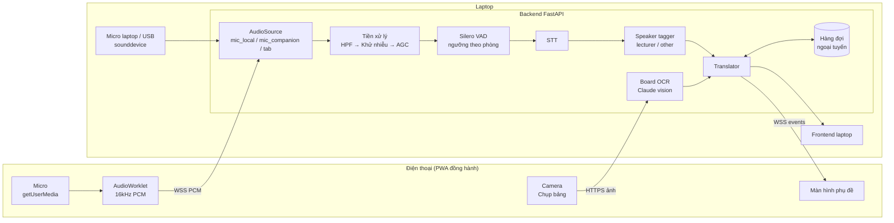
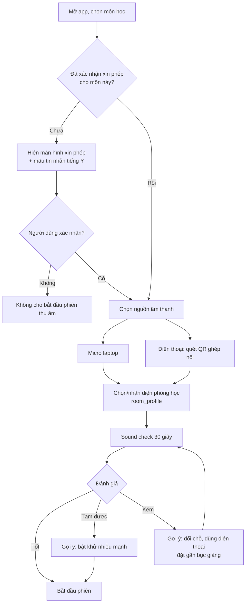
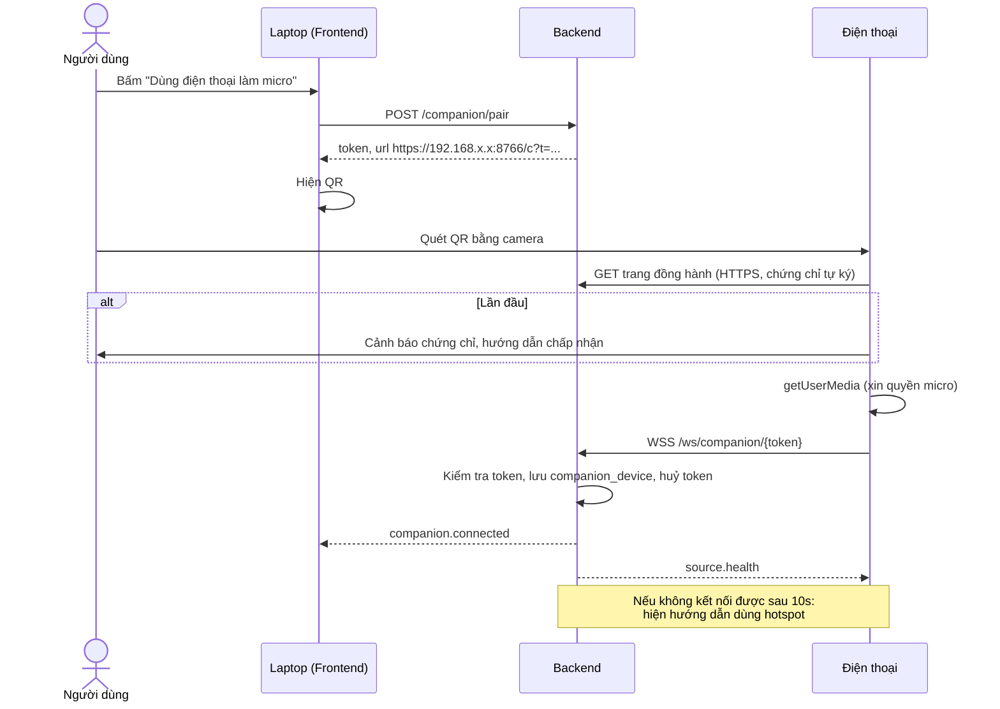
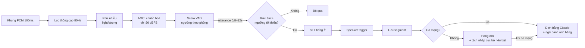

# Feature Spec: Chế độ Lớp học trực tiếp (In-Class Mode)

> Mở rộng LezioneLive: thu âm lời giảng **trong phòng học thật** bằng micro của laptop, điện thoại hoặc micro rời, sau đó nhận dạng, dịch và hỏi đáp như chế độ online. Mục tiêu là giúp du học sinh mới sang hiểu giảng viên đang nói gì.

| Mục | Giá trị |
|---|---|
| Mã tính năng | FEAT-INCLASS |
| Phiên bản | 1.0 |
| Ngày | 29/09/2026 |
| Tài liệu gốc | `app_spec.md` (v1.0) |
| Trạng thái | Draft, chờ review |
| Phụ thuộc | Hoàn thành Phase 1–2 của `app_spec.md` (pipeline VAD → STT → dịch, trợ lý Claude) |

---

## Mục lục

1. [Tổng quan](#1-tổng-quan)
2. [Khác biệt so với chế độ online](#2-khác-biệt-so-với-chế-độ-online)
3. [User Stories](#3-user-stories)
4. [Yêu cầu chức năng](#4-yêu-cầu-chức-năng)
5. [Yêu cầu phi chức năng](#5-yêu-cầu-phi-chức-năng)
6. [Kiến trúc và thay đổi kỹ thuật](#6-kiến-trúc-và-thay-đổi-kỹ-thuật)
7. [Thay đổi dữ liệu và API](#7-thay-đổi-dữ-liệu-và-api)
8. [Các luồng xử lý](#8-các-luồng-xử-lý)
9. [Thiết kế Prompt bổ sung](#9-thiết-kế-prompt-bổ-sung)
10. [Giao diện](#10-giao-diện)
11. [Quyền riêng tư và sự đồng ý](#11-quyền-riêng-tư-và-sự-đồng-ý)
12. [Xử lý lỗi](#12-xử-lý-lỗi)
13. [Kế hoạch triển khai](#13-kế-hoạch-triển-khai)
14. [Acceptance Criteria](#14-acceptance-criteria)
15. [Kế hoạch kiểm thử](#15-kế-hoạch-kiểm-thử)
16. [Rủi ro](#16-rủi-ro)
17. [Câu hỏi mở](#17-câu-hỏi-mở)

---

## 1. Tổng quan

### 1.1 Vấn đề

Khi sang Ý học trực tiếp, sinh viên không còn nguồn âm thanh "sạch" từ MS Teams. Lời giảng phải thu qua không khí, nên gặp nhiều vấn đề:

- Giảng viên đứng xa, đi lại, có lúc quay lưng về phía lớp để viết bảng.
- Phòng học có tiếng vang, tiếng quạt/điều hoà, tiếng sinh viên nói chuyện, tiếng gõ phím.
- Có sinh viên đặt câu hỏi từ nhiều vị trí trong phòng.
- Nội dung trên bảng hoặc slide chiếu không có file điện tử.
- Wi-Fi của trường có thể chập chờn hoặc chặn kết nối giữa các thiết bị.

### 1.2 Mục tiêu

| # | Mục tiêu | Chỉ số |
|---|---|---|
| G1 | Nhận dạng lời giảng đủ tốt trong phòng học | WER ≤ 25% khi ngồi trong 3 hàng đầu (≤ 6m từ giảng viên) |
| G2 | Hiểu bài theo thời gian thực | Bản dịch tiếng Việt hoàn chỉnh p50 ≤ 6s, p95 ≤ 10s |
| G3 | Dùng được cả khi Wi-Fi yếu | Phụ đề tiếng Ý vẫn chạy khi mất mạng; dịch bù khi có mạng |
| G4 | Thu được nội dung trên bảng/slide chiếu | Chụp ảnh và đưa vào ngữ cảnh dịch/hỏi đáp trong ≤ 15s |
| G5 | Tôn trọng quyền riêng tư của giảng viên và bạn học | Không lưu âm thanh mặc định; có bước xác nhận đã xin phép |

### 1.3 Ngoài phạm vi

- Phát bản dịch ra loa hoặc chia sẻ phụ đề cho cả lớp (có thể làm ở phiên bản sau, xem Q6).
- Nhận diện danh tính người nói (chỉ phân biệt "giảng viên" và "người khác").
- Ghi hình video bài giảng.
- Thu âm bí mật: tính năng luôn hiển thị rõ trạng thái đang thu.

---

## 2. Khác biệt so với chế độ online

| Khía cạnh | Chế độ online (`app_spec.md`) | Chế độ lớp học trực tiếp |
|---|---|---|
| Nguồn âm thanh | Tab Teams hoặc loopback, âm thanh sạch | Micro thu qua không khí, nhiều nhiễu và vang |
| Tiền xử lý | Không cần | Bắt buộc: lọc nhiễu, tự động điều chỉnh âm lượng (AGC), lọc tần số thấp |
| Người nói | Chủ yếu 1 người (giảng viên) | Giảng viên và sinh viên hỏi từ xa |
| Thiết bị | Laptop | Laptop, điện thoại, hoặc micro rời |
| Mạng | Ổn định ở nhà | Wi-Fi trường, không ổn định |
| Ngữ cảnh hình ảnh | Slide PDF | Ảnh chụp bảng hoặc màn chiếu |
| Hiển thị | Màn hình lớn, bên cạnh Teams | Kín đáo, không làm phiền lớp; dùng được trên điện thoại |
| Pin | Cắm sạc | Có thể không có ổ cắm, cần tiết kiệm pin |

---

## 3. User Stories

| ID | Là… | Tôi muốn… | Để… | Ưu tiên |
|---|---|---|---|---|
| IC-US-01 | du học sinh | dùng micro laptop để thu lời giảng trong phòng học | có phụ đề và bản dịch như khi học online | Must |
| IC-US-02 | du học sinh | kiểm tra chất lượng âm thanh trước giờ học | biết mình nên ngồi đâu và đặt thiết bị thế nào | Must |
| IC-US-03 | du học sinh | dùng điện thoại làm micro đặt gần giảng viên, còn laptop xử lý và hiển thị | thu âm rõ hơn khi ngồi xa | Should |
| IC-US-04 | du học sinh | xem phụ đề trực tiếp trên điện thoại | không cần mở laptop trong lớp | Should |
| IC-US-05 | du học sinh | phân biệt được lời giảng viên và câu hỏi của bạn học | không bị rối khi đọc | Should |
| IC-US-06 | du học sinh | chụp ảnh bảng hoặc slide chiếu | Claude hiểu công thức và thuật ngữ đang được giảng | Should |
| IC-US-07 | du học sinh | ứng dụng vẫn chạy khi Wi-Fi trường mất | không bỏ lỡ bài | Must |
| IC-US-08 | du học sinh | chế độ tiết kiệm pin cho buổi học 3 giờ | máy không hết pin giữa buổi | Should |
| IC-US-09 | du học sinh | ứng dụng nhắc tôi xin phép giảng viên và ghi nhận việc đó | dùng công cụ đúng quy định | Must |
| IC-US-10 | du học sinh | nhận gợi ý câu hỏi tiếng Ý để hỏi trực tiếp trong lớp | tự tin giơ tay hỏi | Could |

---

## 4. Yêu cầu chức năng

### 4.1 Nguồn âm thanh (Capture Sources)

| ID | Yêu cầu |
|---|---|
| IC-FR-01 | Thêm nguồn `mic_local`: micro của máy đang chạy backend (laptop), chọn được thiết bị cụ thể (micro tích hợp, micro USB, tai nghe). |
| IC-FR-02 | Thêm nguồn `mic_companion`: điện thoại chạy trang web đồng hành (PWA), thu âm bằng `getUserMedia` và gửi PCM tới laptop qua mạng nội bộ. |
| IC-FR-03 | Ghép nối điện thoại bằng mã QR hiển thị trên laptop; QR chứa địa chỉ IP, cổng và token dùng một lần (hết hạn sau 5 phút). |
| IC-FR-04 | Khi dùng `getUserMedia` cho micro: tắt `echoCancellation`, bật `noiseSuppression` và `autoGainControl` của trình duyệt làm lớp xử lý đầu tiên (có thể tắt trong cài đặt để so sánh). |
| IC-FR-05 | Hiện mức âm (VU meter) và chỉ số **SNR ước tính** theo thời gian thực. |
| IC-FR-06 | Giữ màn hình điện thoại không tắt khi đang thu (Screen Wake Lock API). |
| IC-FR-07 | Khi kết nối điện thoại bị ngắt, tự động chuyển sang micro laptop (nếu người dùng bật tuỳ chọn) và thông báo. |

### 4.2 Tiền xử lý âm thanh

| ID | Yêu cầu |
|---|---|
| IC-FR-10 | Pipeline tiền xử lý phía backend trước VAD: lọc thông cao 80Hz → khử nhiễu → chuẩn hoá âm lượng. |
| IC-FR-11 | Khử nhiễu có 3 mức: `off`, `light` (RNNoise), `strong` (DeepFilterNet). Mặc định `light`. |
| IC-FR-12 | Tăng độ nhạy VAD cho môi trường ồn: ngưỡng xác suất lời nói điều chỉnh được (mặc định 0,6 thay vì 0,5); bỏ đoạn < 0,8s. |
| IC-FR-13 | Không đưa vào STT các đoạn có mức âm quá thấp (lời thì thầm gần micro, tiếng ồn nền) theo ngưỡng hiệu chỉnh ở bước kiểm tra âm thanh. |

### 4.3 Kiểm tra âm thanh trước giờ học (Sound Check)

| ID | Yêu cầu |
|---|---|
| IC-FR-20 | Bước kiểm tra 30 giây gồm: (1) 10 giây im lặng để đo tiếng ồn nền; (2) 20 giây khi giảng viên bắt đầu nói (hoặc người dùng tự nói từ khoảng cách tương đương). |
| IC-FR-21 | Kết quả gồm: mức ồn nền (dBFS), SNR ước tính, và đánh giá **Tốt / Tạm được / Kém**. |
| IC-FR-22 | Khi kết quả Kém, đưa ra gợi ý cụ thể: ngồi gần hơn, dùng điện thoại làm micro đặt trên bàn đầu, tránh xa điều hoà/máy chiếu, bật khử nhiễu mạnh. |
| IC-FR-23 | Lưu hồ sơ âm thanh theo phòng học (`room_profile`) để lần sau dùng lại ngưỡng đã hiệu chỉnh. |

### 4.4 Phân biệt người nói

| ID | Yêu cầu |
|---|---|
| IC-FR-30 | Gắn nhãn mỗi segment là `lecturer` hoặc `other` bằng speaker embedding (ví dụ `pyannote` hoặc `speechbrain` ECAPA). |
| IC-FR-31 | Mẫu giọng giảng viên lấy tự động từ 2 phút đầu (người nói chiếm thời lượng nhiều nhất). Người dùng có thể sửa nhãn thủ công; hệ thống học lại từ sửa đổi. |
| IC-FR-32 | Hiển thị segment `other` với kiểu khác (thụt lề, màu nhạt, nhãn "Sinh viên hỏi"). |
| IC-FR-33 | Có thể tắt tính năng này để tiết kiệm tài nguyên; khi tắt, mọi segment gán nhãn `unknown`. |

### 4.5 Chụp bảng và slide chiếu

| ID | Yêu cầu |
|---|---|
| IC-FR-40 | Nút "Chụp bảng" trên điện thoại hoặc laptop (webcam hoặc chọn ảnh). Ảnh được gắn với mốc thời gian hiện tại của phiên. |
| IC-FR-41 | Gửi ảnh cho Claude (vision) để trích xuất: văn bản tiếng Ý, công thức (LaTeX), thuật ngữ mới. Kết quả lưu thành `board_capture`. |
| IC-FR-42 | Thuật ngữ trích xuất được đề xuất vào glossary (người dùng duyệt) và nội dung được đưa vào ngữ cảnh dịch của 10 phút tiếp theo. |
| IC-FR-43 | Ảnh hiển thị xen kẽ trong transcript tại đúng mốc thời gian; xuất kèm trong file ghi chú. |
| IC-FR-44 | Tự thu nhỏ ảnh về cạnh dài tối đa 1568px trước khi gửi để giảm chi phí. |

### 4.6 Chế độ ngoại tuyến

| ID | Yêu cầu |
|---|---|
| IC-FR-50 | Khi mất Internet: STT cục bộ vẫn chạy, segment được lưu với trạng thái `pending_translation`. |
| IC-FR-51 | Có tuỳ chọn "Dịch nháp ngoại tuyến" bằng model dịch cục bộ nhỏ (ví dụ Opus-MT it→en hoặc NLLB), đánh dấu rõ "bản nháp". Khi có mạng, bản dịch Claude thay thế bản nháp. |
| IC-FR-52 | Nếu điện thoại và laptop không kết nối được qua Wi-Fi trường, hướng dẫn dùng điểm phát Wi-Fi (hotspot) của laptop hoặc điện thoại. |

### 4.7 Hiển thị trên điện thoại

| ID | Yêu cầu |
|---|---|
| IC-FR-60 | Trang đồng hành có 2 chế độ: **Micro** (chỉ thu âm, màn hình tối) và **Phụ đề** (hiện bản dịch). |
| IC-FR-61 | Chế độ Phụ đề: chữ lớn, nền tối, chỉ hiện 3–5 segment gần nhất, có nút Ghim và nút "Giải thích" (gửi câu hỏi nhanh tới Claude). |
| IC-FR-62 | Một thiết bị có thể vừa thu âm vừa hiện phụ đề (dùng điện thoại duy nhất khi không mang laptop). Khi đó backend vẫn chạy trên laptop hoặc dùng STT cloud (xem Q2). |

### 4.8 Tiết kiệm pin

| ID | Yêu cầu |
|---|---|
| IC-FR-70 | Chế độ tiết kiệm pin: dùng Whisper `small` int8, tắt phân biệt người nói, giảm tần suất cập nhật UI xuống 1 lần/giây. |
| IC-FR-71 | Hiển thị ước tính thời gian pin còn lại dựa trên mức tiêu thụ 10 phút gần nhất (Battery Status API nếu có, hoặc `psutil` trên laptop). |
| IC-FR-72 | Cảnh báo khi pin < 20% và gợi ý bật chế độ tiết kiệm. |

### 4.9 Xin phép và minh bạch

| ID | Yêu cầu |
|---|---|
| IC-FR-80 | Trước phiên đầu tiên của mỗi môn, hiện màn hình xác nhận: "Tôi đã xin phép giảng viên sử dụng công cụ phụ đề cho bài giảng này". Lưu thời điểm xác nhận vào `course`. |
| IC-FR-81 | Cung cấp mẫu email/tin nhắn tiếng Ý xin phép giảng viên (Claude soạn, người dùng chỉnh sửa). |
| IC-FR-82 | Trong lúc thu, luôn hiển thị chỉ báo đang thu âm trên mọi thiết bị liên quan. |
| IC-FR-83 | Mặc định không lưu âm thanh gốc; chỉ lưu văn bản. Nếu người dùng bật lưu âm thanh, cần xác nhận thêm lần nữa. |

---

## 5. Yêu cầu phi chức năng

| ID | Yêu cầu |
|---|---|
| IC-NFR-01 | Độ trễ bản dịch hoàn chỉnh: p50 ≤ 6s, p95 ≤ 10s (cho phép chậm hơn chế độ online 1–2s do tiền xử lý). |
| IC-NFR-02 | WER lời giảng ≤ 25% khi SNR ≥ 15dB; ≤ 35% khi SNR 10–15dB. |
| IC-NFR-03 | Khử nhiễu `light` thêm độ trễ ≤ 50ms mỗi khung; `strong` ≤ 200ms. |
| IC-NFR-04 | Độ trễ truyền âm thanh điện thoại → laptop qua mạng nội bộ ≤ 300ms (p95). |
| IC-NFR-05 | Laptop chạy 3 giờ ở chế độ tiết kiệm pin với mức tiêu thụ ≤ 60% pin (máy pin ≥ 50Wh). |
| IC-NFR-06 | Kết nối điện thoại dùng WSS (TLS) với chứng chỉ tự ký do app tạo; token ghép nối dùng một lần. |
| IC-NFR-07 | Không có âm thanh nào rời khỏi thiết bị của người dùng, trừ khi người dùng chọn STT cloud (có cảnh báo). |

---

## 6. Kiến trúc và thay đổi kỹ thuật

### 6.1 Sơ đồ



### 6.2 Interface `AudioSource` (thay đổi so với `app_spec.md`)

Tách phần nhận âm thanh thành một interface chung để pipeline không phụ thuộc vào nguồn:

```python
class AudioSource(Protocol):
    kind: Literal["tab", "loopback", "mic_local", "mic_companion"]
    sample_rate: int  # luôn 16000 sau khi chuẩn hoá

    async def start(self) -> None: ...
    async def stop(self) -> None: ...
    def frames(self) -> AsyncIterator[np.ndarray]: ...  # khung int16, 100ms
    def health(self) -> SourceHealth: ...  # connected, level_dbfs, snr_db
```

### 6.3 Thư viện mới

| Mục đích | Thư viện | Ghi chú |
|---|---|---|
| Thu micro laptop | `sounddevice` | Liệt kê thiết bị, chọn theo tên |
| Khử nhiễu nhẹ | `rnnoise` (qua `pyrnnoise`) | Nhanh, chạy CPU |
| Khử nhiễu mạnh | `deepfilternet` | Tốt hơn nhưng nặng hơn |
| Phân biệt người nói | `speechbrain` (ECAPA-TDNN) | Tính embedding mỗi segment, so cosine với mẫu giảng viên |
| Dịch nháp ngoại tuyến | `ctranslate2` + Opus-MT/NLLB | Tuỳ chọn |
| Chứng chỉ TLS nội bộ | `cryptography` | Tạo chứng chỉ tự ký khi cài đặt |
| QR ghép nối | `qrcode` (backend) | Hiện trên frontend laptop |

### 6.4 Kết nối điện thoại và laptop

- Trình duyệt điện thoại chỉ cho dùng micro trên **secure context** (HTTPS). Vì vậy backend phải phục vụ trang đồng hành qua HTTPS trên IP nội bộ, dùng chứng chỉ tự ký.
- Lần đầu, điện thoại phải chấp nhận chứng chỉ (hướng dẫn từng bước cho iOS Safari và Android Chrome).
- Wi-Fi của trường có thể bật **client isolation** (chặn các thiết bị nói chuyện với nhau). Khi đó dùng hotspot của laptop hoặc điện thoại.
- Backend lắng nghe thêm trên `0.0.0.0:8766` **chỉ khi** chế độ companion đang bật, và chỉ chấp nhận kết nối có token hợp lệ.

### 6.5 Cấu trúc thư mục bổ sung

```
backend/app/
├── audio/
│   ├── sources/
│   │   ├── base.py            # AudioSource protocol
│   │   ├── tab.py
│   │   ├── loopback.py
│   │   ├── mic_local.py       # MỚI
│   │   └── mic_companion.py   # MỚI
│   ├── preprocess.py          # MỚI: HPF, denoise, AGC
│   ├── soundcheck.py          # MỚI: đo SNR, đánh giá
│   └── speaker_tagger.py      # MỚI
├── companion/
│   ├── pairing.py             # MỚI: token, QR
│   └── tls.py                 # MỚI: tạo chứng chỉ tự ký
├── llm/
│   ├── board_ocr.py           # MỚI
│   └── prompts/
│       ├── board_ocr_v1.md    # MỚI
│       └── translate_inclass_v1.md  # MỚI
└── offline/
    └── draft_translator.py    # MỚI (tuỳ chọn)

frontend/src/
├── pages/
│   ├── SoundCheck.tsx         # MỚI
│   └── companion/             # MỚI: PWA cho điện thoại
│       ├── Pair.tsx
│       ├── MicMode.tsx
│       └── SubtitleMode.tsx
└── components/
    ├── SnrGauge.tsx           # MỚI
    ├── SpeakerBadge.tsx       # MỚI
    └── BoardCaptureCard.tsx   # MỚI
```

---

## 7. Thay đổi dữ liệu và API

### 7.1 Dữ liệu

| Bảng | Thay đổi |
|---|---|
| `session` | Thêm `capture_source` (`tab`/`loopback`/`mic_local`/`mic_companion`), `room_profile_id`, `denoise_level`, `battery_saver` |
| `segment` | Thêm `speaker` (`lecturer`/`other`/`unknown`), `speaker_score`, `snr_db`, `translation_kind` (`claude`/`draft`) |
| `course` | Thêm `consent_confirmed_at` |
| `room_profile` (mới) | `id`, `name` (ví dụ "Aula 5 — Ecotekne"), `noise_floor_dbfs`, `vad_threshold`, `recommended_denoise`, `updated_at` |
| `board_capture` (mới) | `id`, `session_id`, `t_ms`, `image_path`, `extracted_it`, `extracted_latex`, `terms_json`, `created_at` |
| `companion_device` (mới) | `id`, `name`, `paired_at`, `last_seen_at`, `revoked` |

### 7.2 API mới

| Method | Endpoint | Mô tả |
|---|---|---|
| GET | `/audio/devices` | Danh sách micro trên laptop |
| POST | `/soundcheck` | Bắt đầu kiểm tra âm thanh `{ source, device_id?, room_profile_id? }` |
| GET | `/soundcheck/{id}` | Kết quả: `noise_floor_dbfs`, `snr_db`, `rating`, `tips[]` |
| CRUD | `/room-profiles` | Quản lý hồ sơ phòng học |
| POST | `/companion/pair` | Tạo token và QR ghép nối (hết hạn 5 phút) |
| GET | `/companion/devices` | Danh sách thiết bị đã ghép |
| DELETE | `/companion/devices/{id}` | Thu hồi thiết bị |
| POST | `/sessions/{id}/board-captures` | Upload ảnh bảng (multipart), trả về kết quả trích xuất |
| PATCH | `/segments/{id}/speaker` | Sửa nhãn người nói |
| POST | `/courses/{id}/consent` | Ghi nhận xác nhận đã xin phép |
| POST | `/courses/{id}/consent-message` | Claude soạn tin nhắn tiếng Ý xin phép giảng viên |

### 7.3 WebSocket bổ sung

| Endpoint | Hướng | Nội dung |
|---|---|---|
| `wss://<ip>:8766/ws/companion/{token}` | Điện thoại → Laptop | PCM 16kHz mono như chế độ tab |
| (cùng kết nối) | Laptop → Điện thoại | Sự kiện `segment.*`, `source.health`, `warning` để hiện phụ đề |

Sự kiện mới gửi tới mọi client:

| `type` | Payload |
|---|---|
| `source.health` | `{ source, connected, level_dbfs, snr_db }` (mỗi 1 giây) |
| `segment.speaker` | `{ id, speaker, score }` |
| `board.captured` | `{ id, t_ms, thumb_url, extracted_it, terms }` |
| `network.state` | `{ online: bool, pending_translations: int }` |

---

## 8. Các luồng xử lý

### 8.1 Flow A: Chuẩn bị trước giờ học



### 8.2 Flow B: Ghép nối điện thoại



### 8.3 Flow C: Xử lý âm thanh trong buổi học



### 8.4 Flow D: Chụp bảng

1. Người dùng bấm "Chụp bảng" (điện thoại hoặc laptop).
2. Ảnh được thu nhỏ và gửi `POST /sessions/{id}/board-captures` kèm mốc thời gian.
3. Claude (Sonnet 5, vision) trả về JSON: văn bản tiếng Ý, công thức LaTeX, danh sách thuật ngữ, bản dịch tiếng Việt.
4. Backend lưu `board_capture`, emit `board.captured`, thêm nội dung vào ngữ cảnh dịch trong 10 phút tới.
5. Thuật ngữ mới hiện dưới dạng đề xuất; người dùng bấm ✓ để thêm vào glossary.

### 8.5 Flow E: Mất mạng giữa buổi

1. Backend kiểm tra kết nối tới API mỗi 10 giây và khi có lỗi mạng.
2. Khi mất mạng: emit `network.state {online:false}`, segment mới vào hàng đợi; nếu bật dịch nháp, chạy model cục bộ.
3. Khi có mạng lại: dịch bù theo thứ tự thời gian, gộp tối đa 5 segment mỗi request để đuổi kịp nhanh hơn; segment đang diễn ra được ưu tiên dịch trước phần tồn đọng.

---

## 9. Thiết kế Prompt bổ sung

### 9.1 Dịch trong lớp học (`translate_inclass_v1.md`)

Kế thừa `translate_v1.md`, thêm các quy tắc:

```text
BỐI CẢNH BỔ SUNG:
- Văn bản được thu từ micro trong phòng học thật, có thể thiếu từ, lặp từ,
  hoặc chèn tiếng ồn. Bỏ qua từ đệm (ehm, allora, cioè, diciamo) nếu không
  mang nghĩa.
- Người nói: {speaker_label}. Nếu là "other" (sinh viên hỏi), dịch dưới dạng
  câu hỏi và giữ văn phong hội thoại.
- Giảng viên có thể chỉ vào bảng ("questo qui", "come vedete"). Dùng nội dung
  bảng gần nhất bên dưới để làm rõ nghĩa nếu cần.

NỘI DUNG BẢNG/SLIDE GẦN NHẤT (có thể rỗng):
{recent_board_text}
```

### 9.2 Trích xuất bảng (`board_ocr_v1.md`)

```text
Đây là ảnh chụp bảng hoặc màn chiếu trong một lớp học đại học tại Ý
(môn {course_name}). Ảnh có thể nghiêng, loá, hoặc bị che một phần.

Trả về DUY NHẤT một JSON:
{
  "text_it": "toàn bộ chữ đọc được, giữ xuống dòng",
  "latex": ["công thức 1", "..."],
  "terms": [{"it": "...", "vi": "...", "en": "..."}],
  "translation_vi": "bản dịch tiếng Việt của text_it",
  "unreadable": "mô tả vùng không đọc được, hoặc chuỗi rỗng"
}
Không bịa nội dung không nhìn thấy rõ.
```

### 9.3 Tin nhắn xin phép giảng viên (`consent_message_v1.md`)

Đầu vào: tên giảng viên, tên môn, tên sinh viên. Đầu ra JSON gồm `email_it` (trang trọng, ngắn gọn, nói rõ: là sinh viên quốc tế mới đang học tiếng Ý, công cụ tạo phụ đề và bản dịch cho mục đích học tập cá nhân, không chia sẻ lại, không lưu âm thanh) và `back_translation_vi`.

---

## 10. Giao diện

### 10.1 Laptop: màn hình Sound Check

```
┌──────────────────────────────────────────────────────────┐
│  Kiểm tra âm thanh — Aula 5                              │
│                                                          │
│  Nguồn: [Micro điện thoại (Pixel) ▾]                     │
│                                                          │
│  Bước 1: Giữ yên lặng ...  ███████████░░ 8/10s           │
│  Bước 2: Chờ giảng viên nói ...                          │
│                                                          │
│  Ồn nền:  -52 dBFS                                       │
│  SNR:     ▮▮▮▮▮▮▯▯▯▯  12 dB    Đánh giá: 🟡 Tạm được     │
│                                                          │
│  💡 Gợi ý: Bật khử nhiễu mạnh, hoặc đặt điện thoại      │
│     trên bàn hàng đầu, hướng micro về bục giảng.         │
│                                                          │
│        [Kiểm tra lại]     [Bắt đầu buổi học →]           │
└──────────────────────────────────────────────────────────┘
```

### 10.2 Laptop: màn hình buổi học (bổ sung so với `app_spec.md`)

- Thanh trạng thái thêm: biểu tượng nguồn (💻 / 📱), SNR hiện tại, trạng thái mạng, pin.
- Segment có huy hiệu người nói: 🎓 Giảng viên / 🙋 Sinh viên.
- Ảnh bảng hiện dạng thẻ xen kẽ trong transcript tại đúng mốc thời gian, bấm để phóng to và xem bản trích xuất.
- Nút 📷 "Chụp bảng" trên thanh công cụ.

### 10.3 Điện thoại: chế độ Phụ đề

```
┌─────────────────────────┐
│ ● REC  01:12:40  📶 🔋62%│
├─────────────────────────┤
│ 🎓 Quindi la varianza…   │
│    Vậy phương sai…       │
│                         │
│ 🎓 Se il campione è…     │
│    Nếu mẫu đủ lớn thì…   │
│                         │
│ 🙋 Professore, scusi…    │
│    Thưa thầy, cho em hỏi…│
├─────────────────────────┤
│  📌 Ghim  💡 Giải thích  📷│
└─────────────────────────┘
```

- Nền tối, độ sáng thấp để không làm phiền người bên cạnh.
- Chữ tối thiểu 18px; kéo lên để xem lịch sử, tự quay về cuối sau 10 giây không thao tác.

### 10.4 Điện thoại: chế độ Micro

Màn hình gần như đen, chỉ hiện chấm đỏ REC, mức âm và SNR. Mục đích: tiết kiệm pin khi điện thoại chỉ đặt trên bàn làm micro.

---

## 11. Quyền riêng tư và sự đồng ý

> Phần này không phải tư vấn pháp lý. Cần kiểm tra quy chế của Đại học Salento và hỏi trực tiếp giảng viên.

- **Xin phép trước:** Ghi âm bài giảng ở Ý chịu quy định bảo vệ dữ liệu (GDPR) và quy chế của trường. Giọng nói của giảng viên và bạn học là dữ liệu cá nhân. Ứng dụng bắt buộc bước xác nhận đã xin phép cho từng môn (IC-FR-80).
- **Giảm thiểu dữ liệu:** Mặc định không lưu âm thanh; chỉ lưu văn bản. Âm thanh chỉ tồn tại trong bộ nhớ trong lúc xử lý.
- **Câu hỏi của bạn học:** Segment gán nhãn `other` có tuỳ chọn "Không lưu lời người khác" (chỉ hiển thị trong lúc học, không ghi vào DB và không đưa vào tóm tắt).
- **Minh bạch:** Luôn có chỉ báo đang thu. Không có chế độ thu ẩn.
- **Không chia sẻ:** Transcript chỉ dùng cho mục đích học tập cá nhân; chức năng export có dòng nhắc này ở đầu file.
- **Hỗ trợ chính thức:** Nhiều trường có dịch vụ hỗ trợ sinh viên quốc tế hoặc dịch vụ hỗ trợ học tập. Nên hỏi xem trường có chính sách hoặc công cụ phụ đề chính thức không (xem Q5).

---

## 12. Xử lý lỗi

| Mã | Tình huống | Hành vi | Thông báo |
|---|---|---|---|
| IC-E-01 | Người dùng từ chối quyền micro | Không bắt đầu phiên | Hướng dẫn bật quyền micro cho trình duyệt/hệ điều hành |
| IC-E-02 | Điện thoại không kết nối được tới laptop | Sau 10 giây hiện hướng dẫn | "Wi-Fi trường có thể chặn kết nối giữa thiết bị. Hãy bật hotspot trên laptop và cho điện thoại kết nối vào." |
| IC-E-03 | Điện thoại mất kết nối giữa buổi | Chuyển sang micro laptop nếu bật tuỳ chọn; ghi mốc gián đoạn trong transcript | Toast + rung trên điện thoại |
| IC-E-04 | SNR < 8dB kéo dài 2 phút | Tiếp tục chạy | "Âm thanh đang rất nhiễu, bản dịch có thể sai nhiều. Thử bật khử nhiễu mạnh hoặc đổi vị trí micro." |
| IC-E-05 | Khử nhiễu mạnh làm tăng độ trễ quá ngưỡng | Tự hạ xuống `light` | Thông báo đã tự điều chỉnh |
| IC-E-06 | Ảnh bảng không đọc được | Lưu ảnh, không trích xuất | "Không đọc được ảnh. Thử chụp thẳng góc, tránh loá đèn." |
| IC-E-07 | Pin < 10% | Tự bật chế độ tiết kiệm, đảm bảo transcript đã ghi xuống đĩa | Cảnh báo |
| IC-E-08 | Token ghép nối hết hạn | Từ chối kết nối | Điện thoại hiện "Mã QR đã hết hạn, hãy tạo mã mới" |

---

## 13. Kế hoạch triển khai

> Ước tính cho 1 người làm part-time. **d** = ngày công.

### Phase IC-0: Spike (3d)

| # | Task | Ước tính | Đầu ra |
|---|---|---|---|
| 0.1 | Thu 3 bản ghi thử trong phòng học thật hoặc phòng mô phỏng (phát bài giảng tiếng Ý qua loa ở khoảng cách 3m, 6m, 10m) | 1d | Bộ dữ liệu kiểm thử có transcript chuẩn |
| 0.2 | So sánh WER: không khử nhiễu / RNNoise / DeepFilterNet × Whisper turbo / small | 1d | Bảng WER và độ trễ, chọn cấu hình mặc định |
| 0.3 | Thử HTTPS + getUserMedia trên iPhone và Android qua IP nội bộ và qua hotspot | 1d | Xác nhận phương án companion khả thi |

**Gate:** Nếu WER ở 6m > 40% với mọi cấu hình, ưu tiên phương án điện thoại đặt gần giảng viên hoặc micro rời, và hạ mục tiêu G1 cho ghế xa.

### Phase IC-1: Micro laptop + tiền xử lý (5d)

| # | Task | Ước tính |
|---|---|---|
| 1.1 | Tách `AudioSource` interface, refactor tab/loopback theo interface | 1d |
| 1.2 | `mic_local` + chọn thiết bị | 0,5d |
| 1.3 | `preprocess.py`: HPF, RNNoise, DeepFilterNet, AGC | 1,5d |
| 1.4 | Sound check + `room_profile` + UI | 1,5d |
| 1.5 | Chỉ báo SNR trong phiên, cảnh báo IC-E-04 | 0,5d |

### Phase IC-2: Xin phép và ngoại tuyến (3d)

| # | Task | Ước tính |
|---|---|---|
| 2.1 | Màn hình xác nhận xin phép + soạn tin nhắn tiếng Ý | 1d |
| 2.2 | Hàng đợi ngoại tuyến, phát hiện mạng, dịch bù | 1,5d |
| 2.3 | Tuỳ chọn "Không lưu lời người khác" | 0,5d |

### Phase IC-3: Điện thoại đồng hành (6d)

| # | Task | Ước tính |
|---|---|---|
| 3.1 | Tạo chứng chỉ tự ký, server HTTPS/WSS cổng 8766 | 1d |
| 3.2 | Ghép nối QR + token + quản lý thiết bị | 1d |
| 3.3 | PWA: chế độ Micro (getUserMedia, AudioWorklet, Wake Lock) | 1,5d |
| 3.4 | PWA: chế độ Phụ đề + Ghim + Giải thích | 1,5d |
| 3.5 | Fallback micro laptop khi mất kết nối; hướng dẫn hotspot | 1d |

### Phase IC-4: Người nói và chụp bảng (5d)

| # | Task | Ước tính |
|---|---|---|
| 4.1 | Speaker tagger ECAPA + tự lấy mẫu giảng viên | 2d |
| 4.2 | UI huy hiệu người nói + sửa nhãn | 0,5d |
| 4.3 | Chụp bảng: upload, Claude vision, lưu, hiển thị trong transcript | 1,5d |
| 4.4 | Đưa nội dung bảng vào ngữ cảnh dịch + đề xuất glossary | 1d |

### Phase IC-5: Pin và hoàn thiện (3d)

| # | Task | Ước tính |
|---|---|---|
| 5.1 | Chế độ tiết kiệm pin + ước tính pin | 1d |
| 5.2 | Dịch nháp ngoại tuyến (tuỳ chọn) | 1d |
| 5.3 | Soak test 3 giờ trên pin, sửa lỗi, cập nhật README | 1d |

**Tổng:** khoảng 25 ngày công (5–7 tuần part-time).

### Milestones

| Mốc | Tiêu chí |
|---|---|
| IC-M1 | Dùng micro laptop trong 1 buổi học thật, có phụ đề và bản dịch |
| IC-M2 | Dùng điện thoại làm micro trong 1 buổi học thật |
| IC-M3 | Buổi học có ảnh bảng và nhãn người nói trong file ghi chú |
| IC-M4 | Chạy trọn buổi 3 giờ trên pin |

---

## 14. Acceptance Criteria

### IC-AC-01: Micro laptop (IC-US-01)
- **Given** đã xác nhận xin phép và chọn micro laptop, **When** bắt đầu phiên và giảng viên nói, **Then** VU meter phản hồi trong ≤ 1 giây và segment tiếng Ý đầu tiên xuất hiện trong ≤ 4 giây sau khi câu nói kết thúc.
- **Given** bản ghi kiểm thử phát ở khoảng cách 3m với SNR ≥ 15dB, **When** xử lý với cấu hình mặc định, **Then** WER ≤ 25%.

### IC-AC-02: Sound check (IC-US-02)
- **Given** phòng yên tĩnh và người nói cách 2m, **When** chạy sound check, **Then** đánh giá là "Tốt".
- **Given** có tiếng quạt/ồn nền mạnh (SNR < 10dB), **When** chạy sound check, **Then** đánh giá là "Kém" và có ít nhất 2 gợi ý cụ thể.
- **Given** đã có `room_profile` cho phòng, **When** chọn lại phòng đó, **Then** ngưỡng VAD và mức khử nhiễu được áp dụng tự động.

### IC-AC-03: Điện thoại làm micro (IC-US-03)
- **Given** laptop và điện thoại cùng mạng (hoặc hotspot), **When** quét QR, **Then** ghép nối thành công trong ≤ 15 giây (không tính lần đầu chấp nhận chứng chỉ).
- **Given** đã ghép nối, **When** đo độ trễ truyền, **Then** p95 ≤ 300ms.
- **Given** token đã dùng hoặc quá 5 phút, **When** dùng lại QR, **Then** kết nối bị từ chối (IC-E-08).
- **Given** điện thoại mất kết nối và bật fallback, **When** 3 giây trôi qua, **Then** hệ thống chuyển sang micro laptop và transcript có dòng đánh dấu gián đoạn.
- **Given** chế độ Micro đang chạy, **When** để yên 30 phút, **Then** màn hình không tự khoá và vẫn thu âm.

### IC-AC-04: Phụ đề trên điện thoại (IC-US-04)
- **Given** chế độ Phụ đề, **When** có segment mới, **Then** hiện trên điện thoại cùng lúc (sai lệch ≤ 500ms) với laptop.
- **Given** bấm 📌 trên điện thoại, **Then** ghim xuất hiện trên laptop.

### IC-AC-05: Phân biệt người nói (IC-US-05)
- **Given** bản ghi kiểm thử có giảng viên và 2 sinh viên hỏi, **When** xử lý, **Then** ≥ 85% segment của giảng viên được gán `lecturer` và ≥ 70% câu hỏi sinh viên được gán `other`.
- **Given** người dùng sửa nhãn 1 segment, **Then** nhãn được cập nhật ngay và lưu vào DB.
- **Given** bật "Không lưu lời người khác", **When** kết thúc phiên, **Then** DB không có `text_it` của segment `other` và tóm tắt không trích dẫn nội dung đó.

### IC-AC-06: Chụp bảng (IC-US-06)
- **Given** ảnh bảng rõ có công thức và 5 thuật ngữ, **When** chụp, **Then** trong ≤ 15 giây có kết quả với công thức LaTeX đúng và ≥ 4/5 thuật ngữ được đề xuất.
- **Given** ảnh mờ, **Then** trả về IC-E-06 và không bịa nội dung.
- **Given** vừa chụp bảng có "varianza campionaria", **When** giảng viên nói cụm này trong 10 phút sau, **Then** bản dịch dùng đúng thuật ngữ đã duyệt.
- **Given** export ghi chú, **Then** ảnh xuất hiện đúng vị trí thời gian.

### IC-AC-07: Ngoại tuyến (IC-US-07)
- **Given** STT cục bộ và phiên đang chạy, **When** tắt Wi-Fi 5 phút, **Then** text tiếng Ý vẫn xuất hiện liên tục và UI báo "Ngoại tuyến — N câu chờ dịch".
- **Given** có mạng lại, **Then** toàn bộ segment tồn đọng được dịch trong ≤ 3 phút, đúng thứ tự, và segment mới vẫn được dịch kịp thời.
- **Given** bật dịch nháp, **When** ngoại tuyến, **Then** segment có bản nháp gắn nhãn "nháp", được thay bằng bản Claude khi có mạng.

### IC-AC-08: Pin (IC-US-08)
- **Given** laptop pin ≥ 50Wh đầy, chế độ tiết kiệm bật, **When** chạy 3 giờ, **Then** pin tiêu thụ ≤ 60% và không crash.
- **Given** pin < 20%, **Then** hiện cảnh báo đúng 1 lần kèm gợi ý bật chế độ tiết kiệm.

### IC-AC-09: Xin phép (IC-US-09)
- **Given** môn chưa xác nhận xin phép, **When** bấm bắt đầu phiên thu âm trực tiếp, **Then** bị chặn và hiện màn hình xin phép.
- **Given** bấm "Soạn tin xin phép", **Then** nhận được email tiếng Ý trang trọng kèm bản dịch ngược, nêu rõ không lưu âm thanh và không chia sẻ lại.
- **Given** phiên đang thu, **Then** chỉ báo ● REC luôn hiển thị trên mọi thiết bị liên quan.
- **Given** cài đặt mặc định, **When** kết thúc phiên, **Then** không có file âm thanh nào trên đĩa.

### IC-AC-10: Gợi ý câu hỏi trong lớp (IC-US-10)
- **Given** người dùng gõ câu hỏi tiếng Việt trên điện thoại, **When** gửi ở chế độ "Hỏi trong lớp", **Then** nhận được câu tiếng Ý ngắn (≤ 25 từ), dễ đọc thành tiếng, kèm phiên âm gợi ý nhấn âm.

---

## 15. Kế hoạch kiểm thử

| Loại | Nội dung | Công cụ |
|---|---|---|
| Bộ dữ liệu phòng học | Phát bài giảng tiếng Ý công khai qua loa trong phòng thật, thu ở 3m / 6m / 10m, có và không có tiếng ồn nền (quạt, nói chuyện, gõ phím) | Script `eval/record_room.py` |
| Nhiễu tổng hợp | Trộn âm thanh sạch với tạp âm ở SNR 20 / 15 / 10 / 5 dB và thêm tiếng vang (RIR) | `audiomentations` |
| WER | So sánh các cấu hình khử nhiễu × model STT | `jiwer` |
| Người nói | Đo độ chính xác gán nhãn trên bản ghi có nhiều người | Script đánh giá riêng |
| Companion | iOS Safari, Android Chrome; Wi-Fi thường, Wi-Fi có client isolation, hotspot | Kiểm thử thủ công theo checklist |
| Ngoại tuyến | Ngắt mạng theo kịch bản (30s, 5 phút, bật/tắt liên tục) | `toxiproxy` hoặc tắt Wi-Fi thủ công |
| Pin | Chạy 3 giờ trên pin, ghi mức pin mỗi 10 phút | `psutil` |
| Thực tế | 3 buổi học thật, ghi nhật ký vấn đề sau mỗi buổi | Checklist |

---

## 16. Rủi ro

| # | Rủi ro | Khả năng | Ảnh hưởng | Giảm thiểu |
|---|---|---|---|---|
| R1 | Ngồi xa, phòng vang: WER quá cao | Cao | Cao | Điện thoại làm micro gần bục giảng; micro rời; chụp bảng làm ngữ cảnh; sound check gợi ý vị trí |
| R2 | Giảng viên không đồng ý | Trung bình | Cao | Xin phép sớm bằng tin nhắn rõ ràng; nhấn mạnh không lưu âm thanh; nếu bị từ chối, chỉ dùng tính năng chụp bảng + hỏi đáp sau giờ |
| R3 | Wi-Fi trường chặn kết nối thiết bị | Cao | Trung bình | Hotspot; chế độ chỉ-laptop |
| R4 | iOS hạn chế thu âm nền, khoá màn hình | Trung bình | Trung bình | Wake Lock; hướng dẫn giữ app mở ở chế độ Micro; ưu tiên kiểm thử iOS sớm (Phase IC-0) |
| R5 | Khử nhiễu làm méo giọng, giảm độ chính xác | Trung bình | Trung bình | Đo WER có/không khử nhiễu trong Phase IC-0; cho phép tắt |
| R6 | Hết pin giữa buổi | Trung bình | Trung bình | Chế độ tiết kiệm; ưu tiên ngồi gần ổ cắm; ghi transcript liên tục xuống đĩa |
| R7 | Ghi nhận nhầm giọng sinh viên là giảng viên | Trung bình | Thấp | Cho sửa nhãn; tắt được tính năng |
| R8 | Dùng điện thoại/laptop trong lớp gây khó chịu | Thấp | Thấp | Giao diện tối, không âm thanh, không rung (trừ cảnh báo lỗi) |

---

## 17. Câu hỏi mở

| # | Câu hỏi | Ảnh hưởng |
|---|---|---|
| Q1 | Bạn dự định mang laptop vào lớp, hay chỉ muốn dùng điện thoại? | Nếu chỉ dùng điện thoại, cần STT cloud hoặc STT trên thiết bị, thay đổi kiến trúc đáng kể |
| Q2 | Có sẵn sàng mua micro rời (micro cài áo không dây, hoặc micro USB đa hướng) không? | Có thể giải quyết R1 tốt hơn mọi xử lý phần mềm |
| Q3 | Laptop dùng hệ điều hành gì, có GPU không? | Chọn model STT và mức khử nhiễu mặc định |
| Q4 | Điện thoại là iPhone hay Android? | Ưu tiên kiểm thử và hướng dẫn chấp nhận chứng chỉ |
| Q5 | Trường có dịch vụ hỗ trợ sinh viên quốc tế hoặc công cụ phụ đề chính thức không? | Có thể cần tích hợp hoặc không cần tự làm một phần |
| Q6 | Có muốn chia sẻ phụ đề cho các du học sinh khác trong cùng lớp không? | Nếu có, cần thêm chế độ phát (broadcast) nhiều người xem, xác thực và xem lại vấn đề quyền riêng tư |
| Q7 | Tên file: bạn viết `feature_spe.md`, tôi đặt là `feature_spec.md`. Có cần đổi lại không? | Không ảnh hưởng nội dung |
